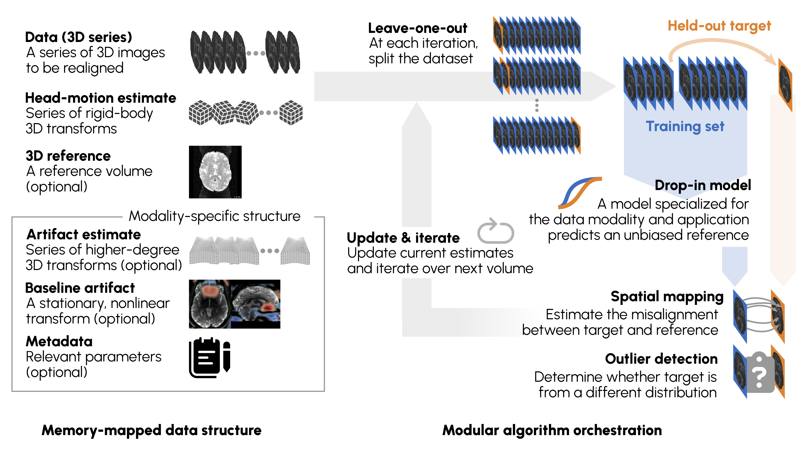

*NiFreeze*
==========

**Model-based estimation and correction of head motion and eddy current distortions in 4D neuroimaging**.

*NiFreeze* is a flexible framework for volume-to-volume motion estimation and correction in d/fMRI and PET,
and eddy-current-derived distortion estimation in dMRI.

.. BEGIN NOTICE AND BADGES (left out of the documentation's home page)

.. important:: *NiFreeze* is a major evolution and generalized successor of *eddymotion*

   In November 2024, the *NiPreps Steering Committee* brought to the *Bi-monthly Roundup*
   the discussion about re-branding *eddymotion* to better reflect its aspirations to
   perform on diverse modalities.

   The `repository of the project <https://github.com/nipreps/eddymotion>`__
   has been archived, and development will continue under the *NiFreeze* project.

   The contributor list of *eddymotion* is found under the credit file
   ``.maint/EDDYMOTION.md`` in this repository.

.. image:: https://img.shields.io/badge/License-Apache_2.0-blue.svg
   :target: https://github.com/nipreps/nifreeze/blob/main/LICENSE
   :alt: License

.. image:: https://img.shields.io/pypi/v/nifreeze.svg
   :target: https://pypi.python.org/pypi/nifreeze/
   :alt: Latest Version

.. image:: https://img.shields.io/badge/SPEC-0-green?labelColor=%23004811&color=%235CA038
   :target: https://scientific-python.org/specs/spec-0000/
   :alt: SPEC 0: Minimum Supported Dependencies

.. image:: https://github.com/nipreps/nifreeze/actions/workflows/citation.yml/badge.svg
   :target: https://github.com/nipreps/nifreeze/actions/workflows/citation.yml
   :alt: Citation

.. image:: https://github.com/nipreps/nifreeze/actions/workflows/test.yml/badge.svg
   :target: https://github.com/nipreps/nifreeze/actions/workflows/test.yml
   :alt: Testing

.. image:: https://github.com/nipreps/nifreeze/actions/workflows/notebooks.yml/badge.svg
   :target: https://github.com/nipreps/nifreeze/actions/workflows/notebooks.yml
   :alt: Examples

.. image:: https://github.com/nipreps/nifreeze/actions/workflows/gallery.yml/badge.svg
   :target: https://github.com/nipreps/nifreeze/actions/workflows/gallery.yml
   :alt: Prediction gallery

.. image:: https://github.com/nipreps/nifreeze/actions/workflows/pages/pages-build-deployment/badge.svg
   :target: https://www.nipreps.org/nifreeze/main/index.html
   :alt: Documentation

.. image:: https://github.com/nipreps/nifreeze/actions/workflows/pythonpackage.yml/badge.svg
   :target: https://github.com/nipreps/nifreeze/actions/workflows/pythonpackage.yml
   :alt: Python package

.. image:: https://github.com/nipreps/nifreeze/actions/workflows/contrib.yml/badge.svg
   :target: https://github.com/nipreps/nifreeze/actions/workflows/contrib.yml
   :alt: Contribution checks

.. image:: https://codecov.io/gh/nipreps/nifreeze/branch/main/graph/badge.svg
   :target: https://app.codecov.io/gh/nipreps/nifreeze
   :alt: Code coverage

.. image:: https://img.shields.io/badge/benchmarked%20by-asv-blue.svg
   :target: https://github.com/nipreps/nifreeze/actions/workflows/benchmark.yml
   :alt: Benchmarks

.. image:: https://img.shields.io/endpoint?url=https://raw.githubusercontent.com/astral-sh/ruff/main/assets/badge/v2.json
   :target: https://github.com/astral-sh/ruff
   :alt: Code format

.. END NOTICE AND BADGES

Diffusion MRI (dMRI), functional MRI and dynamic PET acquire a series of volumes, and the
head moves while the series is acquired.
Realignment usually registers each volume to a reference volume, which works only when all
volumes show the same contrast; contrast changes across the diffusion encodings of dMRI, and
as the tracer distributes during a PET scan.
*NiFreeze* estimates head motion by registering each volume to an *unmoved* prediction of it,
from a model of the signal fit on all the other volumes.
In dMRI, it also estimates the distortions that eddy currents cause.
The `Overview <https://www.nipreps.org/nifreeze/main/introduction/index.html>`__ describes the
problem and the models for each modality.

