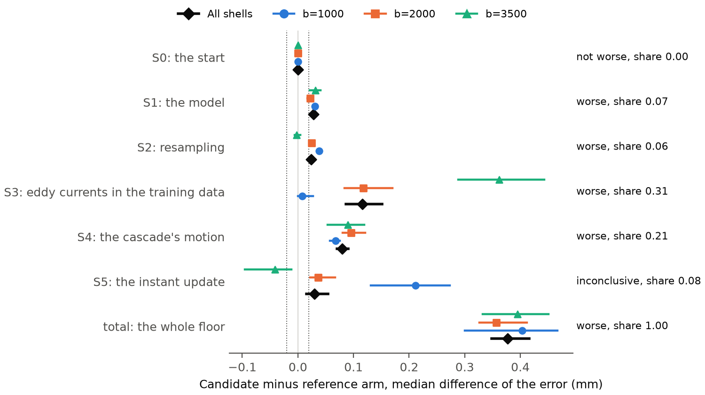
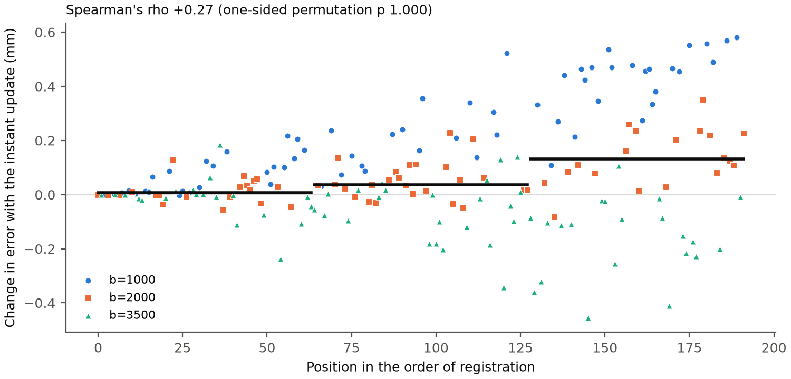
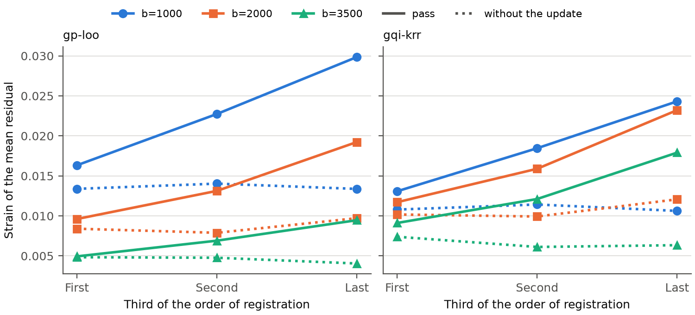
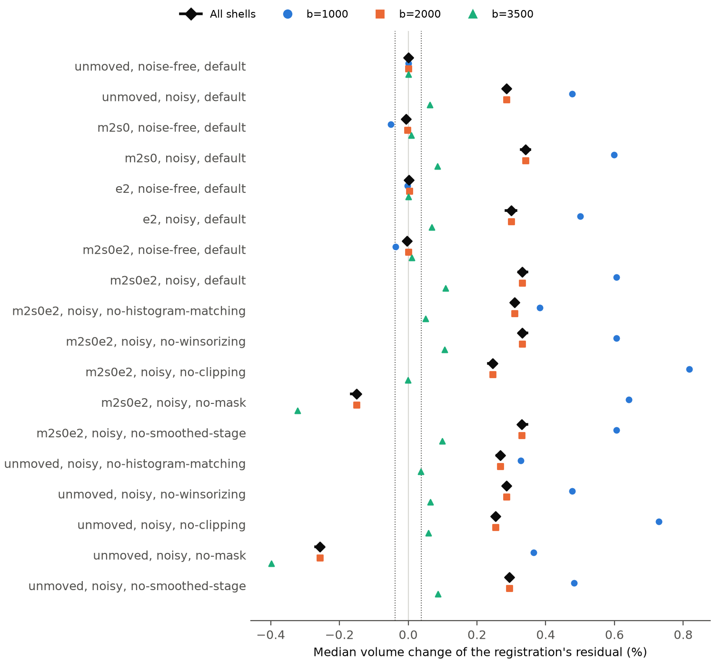

.. include:: ../links.rst

The targets of the eddy-current pass
====================================
*NiFreeze* estimates head motion with a cascade of models (here ``--models gqi-krr
gp-loo``, each level a rigid registration of every volume to the model's held-out
prediction of it), then estimates eddy currents with one more pass (``--eddy``).
That pass registers each diffusion-weighted volume, with an affine, to a model's
held-out prediction, starting from the cascade's head motion.
Its result is the *whole mapping* of the volume: the estimate of how the reference maps
into it, head motion and eddy currents composed.

In the end-to-end test of `#712 <https://github.com/nipreps/nifreeze/issues/712>`__,
the pass left a median largest displacement of 1.185 to 1.648 mm of eddy currents on
the three shells (the reproduction table below), and at b=1000 the whole mapping ended further from the truth than without
the pass (`#721 <https://github.com/nipreps/nifreeze/pull/721>`__).
Three tests on `#723 <https://github.com/nipreps/nifreeze/issues/723>`__ follow that error, each under rules posted before its
run:

Test 1
    It splits the pass's error into steps, from an oracle to the pass.
    It found no single step that makes the floor, and found that the pass drifts: its
    registrations share an expansion, which the instant update feeds back.
Test 2
    It asks why the registrations expand, and finds the noise in the moving volume.
Test 3
    It asks whether a registration with 9 parameters, head motion and a field along
    phase encoding, does better than the affine.

Test 1: what the targets carry
------------------------------
The *floor* is the pass's error minus the oracle's, on the mean error of the whole
mapping defined below.

The question
~~~~~~~~~~~~
Do the targets of the eddy-current pass carry the eddy currents it should correct?
The working hypothesis asked two questions:

1. Which step from the oracle to the pass makes the floor?
   Hypothesis 1 said: the eddy currents that the training data still carry.
2. Hypothesis 2: does the pass's benefit from the *instant update* grow with a volume's
   position in the order of registration?
   With the instant update (:doc:`../design`), each volume, once registered, enters the
   models' training data resampled with its estimate, so later volumes get targets
   drawn from more corrected volumes.
   The order is random, drawn from the run's seed, and the same in every level of the
   cascade and in the pass.

Data
~~~~
The copy
    Sherbrooke ``m2s0e2`` (:doc:`../phantoms`): 192 diffusion-weighted volumes at 2 mm,
    in three shells (b=1000, 2000 and 3500) that share the same 64 directions.
    Every volume moved by 2 mm and 2° (motion seed 0), then was distorted by eddy
    currents of up to 4 mm within the brain.
    It carries the noise of the end-to-end test (seed 20261020).
The truth
    Each volume's head motion ``M``, from the sidecar, and its eddy currents ``E``, from
    :meth:`~nifreeze.analysis.sensitivity.Distortion.matrices`
    (`#724 <https://github.com/nipreps/nifreeze/issues/724>`__).
    The volume shows at ``E M x`` what the reference shows at ``x``
    (:doc:`error-audit`).
    The field is linear in position and in the q-vector: its coefficients are
    ``0.0265 × (b / 1000) × g``, so along the same direction the field at b=2000 and
    b=3500 is 2 and 3.5 times the field at b=1000.
The cascade
    gqi-krr, then gp-loo, rigid, with elastix and seed 12345, run once, as the command
    line chains them.
    Its head motion ``m̂`` is the start of the arms that start from the cascade.

The arms
~~~~~~~~
Each arm registers the copy's noisy volume, for all 192 volumes, to a target and from a
start, with the pass's settings (:data:`~nifreeze.registration.base.AFFINE`, elastix,
one thread, seed 12345).
Every target but the oracle's is a held-out prediction
(:func:`~nifreeze.analysis.sensitivity.held_out_predictions`), by gp-loo and by gqi-krr:
a weighted sum of the other volumes of a realigned copy of the data
(:meth:`~nifreeze.data.base.BaseDataset.realigned`), with the listed estimates applied.

.. list-table:: The arms.
   :header-rows: 1
   :widths: auto

   * - Arm
     - Target
     - Start
   * - ``oracle``
     - the noise-free reference volume
     - ``M``
   * - ``oracle-cascade``
     - the noise-free reference volume
     - ``m̂``
   * - ``reference``
     - prediction from the noisy reference (no motion, no eddy currents)
     - ``M``
   * - ``corrected``
     - prediction from the copy realigned by its true mapping ``E M``
     - ``M``
   * - ``motion-corrected``
     - prediction from the copy realigned by ``M``, its eddy currents left
     - ``M``
   * - ``cascade-corrected``
     - prediction from the copy realigned by ``m̂``: the pass's targets at its start,
       and so the pass without the instant update
     - ``m̂``
   * - ``pass``
     - the pass itself (:class:`~nifreeze.estimator.Estimator` with
       ``estimates="eddy"`` and the instant update), with one thread per registration
     - ``m̂``

How the results are judged
~~~~~~~~~~~~~~~~~~~~~~~~~~
The error of a registration is its estimated whole mapping ``W`` against the truth
``E M``: the mean, within the brain mask, of
:func:`~nifreeze.registration.utils.displacements_within_mask`, in the frame of the
arm's targets.
The targets predicted from data realigned by ``m̂`` (``cascade-corrected`` and ``pass``)
sit in the cascade's frame, so those arms have the cascade's *common offset* removed:
the transform that all of ``m̂`` shares against ``M`` (its mean rotation and
translation, as the end-to-end test computes it).
The other arms have nothing removed.
Beside this error are reported the largest displacement, the eddy-current score of
#712 (``eddy M`` against ``E M``, with ``eddy = W m̂⁻¹`` the estimate with its start
factored out), the whole mapping with each arm's own common offset removed, and κ, the
fraction of each volume's field that the whole mapping recovers (by least squares over
the brain's points).

Each step compares two arms with :func:`experiments.paired_comparison`: candidate minus
the other arm, paired by volume, with a margin of 0.01 voxel (0.02 mm), over all volumes
(resampled within shells) and within each shell.
From the 95% interval of the median difference, a step is "worse" if the interval lies
above the margin, "better" if it lies below zero with the median below the negative
margin, "not worse" if its upper bound is below the margin, and "inconclusive"
otherwise.

.. list-table:: The steps.
   :header-rows: 1
   :widths: auto

   * - Step
     - Measures
     - Candidate
     - Against
   * - S0
     - the start
     - ``oracle-cascade``
     - ``oracle``
   * - S1
     - the model's prediction
     - ``reference``
     - ``oracle``
   * - S2
     - resampling of the training data
     - ``corrected``
     - ``reference``
   * - S3
     - the eddy currents in the training data
     - ``motion-corrected``
     - ``corrected``
   * - S4
     - the cascade's motion error, in the training data and the start
     - ``cascade-corrected``
     - ``motion-corrected``
   * - S5
     - the instant update
     - ``pass``
     - ``cascade-corrected``
   * - Total
     - the floor
     - ``pass``
     - ``oracle``

The working hypothesis
(`posted on #723 <https://github.com/nipreps/nifreeze/issues/723#issuecomment-7070452338>`__)
set two rules, on gp-loo:

Question 1
    A step makes the floor if it is "worse" over all volumes and within every shell, and
    its median difference is at least half the total's; if more than one does, the
    largest decides.
    S3 would mean the targets carry the field: Test 2 then tries targets free of it,
    starting with the pass repeated on its corrected view, and
    `#591 <https://github.com/nipreps/nifreeze/issues/591>`__ waits for Test 2.
    S1 would send Test 2 to the choice of model, and S4 to the coupling of the motion
    and eddy-current passes (E3b in
    `#614 <https://github.com/nipreps/nifreeze/issues/614>`__).
    If no step reaches half, Test 2 takes the largest step that is "worse".
Question 2
    With ``g = e(pass) − e(cascade-corrected)`` the change in each volume's error that
    the instant update makes (negative where it helped; the posted rules call it the
    gain) and ``r`` the volume's position in the order, hypothesis 2 holds if
    Spearman's ρ(r, g) is below zero (one-sided permutation p below 0.05) and the median
    ``g`` of the last third of the order is below the first third's, with the bootstrap
    interval of the difference entirely below the negative margin.
    If it holds, Test 2 starts with the pass repeated; if not, with targets that leave
    out the volumes along the same direction.
    This rule sets which of Test 2's tries comes first.

The checks, posted with the rules: the truth must apply within 1e-9 mm, the pass's and
``cascade-corrected``'s estimates of the first volume of the order must agree within
0.01 mm (both have the same target and start there), and the pass and the cascade must
reproduce #721's run within 0.05 mm on every median of the end-to-end test's scores.

Results
~~~~~~~
By the rules, no step makes the floor, and hypothesis 2 fails in the opposite
direction: the instant update makes the pass worse the later a volume comes.
The answer to the question is partly yes: the targets carry part of the field at b=2000
and b=3500, but not at b=1000.

Question 1
^^^^^^^^^^
The floor is +0.377 mm with gp-loo.
Its largest step is S3, the eddy currents in the training data (+0.116 mm, 31% of the
floor): "worse" at b=2000 and b=3500, but inconclusive at b=1000, so it does not make
the floor.
S4, the cascade's motion error, is "worse" on every shell (+0.079 mm, 21%).
The start (S0) changes nothing: from either start, the registration to a perfect target
ends as close to the truth.
At b=1000, most of the floor comes from S5, the instant update (+0.212 of +0.403 mm); at
b=3500, S5 is "better" (−0.042 mm).

No step reaches half, so by the fallback Test 2 takes the largest step that is "worse":
S3, reading "worse" as the verdict over all volumes (the decision script's reading).
Reading it as "worse" over all volumes and within every shell, as the rule for making
the floor does, only S4 qualifies, and Test 2 would go to the coupling of the passes
instead.
The posted rules do not say which reading holds.

   Each step's median difference of the error, with its 95% interval, over all volumes
   (diamonds) and within each shell, for gp-loo.
   The dotted lines are the margin on either side of zero: a step is "worse" where its
   interval lies right of the right one.
   The text on the right gives the verdict over all volumes and the step's share of the
   floor.

.. csv-table:: The steps for gp-loo: the median difference of the error (mm), with its
   95% interval and verdict, over all volumes and within each shell; the share of the
   floor; and Wilcoxon's p, Holm-adjusted across the steps.
   :file: ../_static/registration/eddy-targets/eddy-targets-steps.csv
   :header-rows: 1
   :widths: auto

Question 2
^^^^^^^^^^
The instant update's change in error grows with the order instead of shrinking:
ρ(r, g) is +0.27 with gp-loo and +0.51 with gqi-krr.
With gp-loo, the median change goes from +0.008 mm in the first third of the order to
+0.131 mm in the last.
The pass's error rises with the order at b=1000 and b=2000, and shows no trend at
b=3500.

   The change in each volume's error that the instant update makes (``pass`` minus
   ``cascade-corrected``, gp-loo), against the volume's position in the order of
   registration.
   Above zero, the update made the volume worse; the black segments are each third's
   median.
   The first volume of the order has the same target and start in both arms, so its
   change is zero.

.. csv-table:: Hypothesis 2's rule, by model: Spearman's ρ(r, g), its one-sided
   permutation p (for ρ below zero) and its two-sided p, the median change of the first
   and last thirds of the order, their difference with its 95% interval, and whether
   the rule holds.
   :file: ../_static/registration/eddy-targets/eddy-targets-order.csv
   :header-rows: 1
   :widths: auto

.. csv-table:: Spearman's ρ of the pass's error against the order, by shell, with its
   two-sided p.
   :file: ../_static/registration/eddy-targets/eddy-targets-order-shells.csv
   :header-rows: 1
   :widths: auto

Checks
^^^^^^
All three hold.
The truth applies to 5.7e-14 mm within the brain.
The pass's and ``cascade-corrected``'s estimates of the first volume of the order agree
to 3e-14 mm (gp-loo) and 5e-14 mm (gqi-krr).
The pass and the cascade reproduce #721's run within 0.043 mm on every median.

.. csv-table:: The end-to-end test's scores (median largest displacement): this run
   against #721's.
   :file: ../_static/registration/eddy-targets/eddy-targets-reproduction.csv
   :header-rows: 1
   :widths: auto

Reported, not used in the decision
^^^^^^^^^^^^^^^^^^^^^^^^^^^^^^^^^^
With the field left in the training data and the true start (``motion-corrected``), the
whole mapping recovers κ = 0.91 of the field at b=1000, and 0.69 at b=2000 and b=3500.
The opening of #723 predicted that this fraction grows with b and is lowest at b=1000;
it is highest at b=1000 and does not grow.
At b=1000, the pass recovers about the same fraction of the field as its starting
targets (κ 0.88 against 0.91, gp-loo), while its error rises from 0.48 to 0.71 mm: the
error that the instant update adds is mostly not along the field.

gqi-krr gives the same steps in the same order (S3 its largest, +0.105 mm, 26%), but its
S5 is "worse" over all volumes (+0.069 mm, 17%), where gp-loo's is inconclusive.

The head-motion error of the cascade's first level (gqi-krr, from unaligned data) falls
with the order; that of its second level (gp-loo, from data the first level aligned)
does not.
No cascade ran without the instant update, so whether the update causes that fall is
not tested.

.. csv-table:: The head-motion error of each level of the cascade against the order:
   Spearman's ρ and its two-sided p.
   :file: ../_static/registration/eddy-targets/eddy-targets-order-cascade.csv
   :header-rows: 1
   :widths: auto

.. csv-table:: The change in error by how many of the volume's two same-direction
   volumes in the other shells were registered before it (64 volumes each).
   The post hoc probes below show that this count tracks the volume's place in the
   order.
   :file: ../_static/registration/eddy-targets/eddy-targets-siblings.csv
   :header-rows: 1
   :widths: auto

.. csv-table:: The steps for gqi-krr.
   :file: ../_static/registration/eddy-targets/eddy-targets-steps-gqi-krr.csv
   :header-rows: 1
   :widths: auto

.. csv-table:: Median error of each arm (mm): the mean and the largest displacement of
   the whole mapping, in the frame of its targets.
   :file: ../_static/registration/eddy-targets/eddy-targets-errors-whole.csv
   :header-rows: 1
   :widths: auto

.. csv-table:: Median error of each arm (mm), with each arm's own common offset removed,
   as the end-to-end test removes it: mean and largest displacement.
   :file: ../_static/registration/eddy-targets/eddy-targets-errors-offset.csv
   :header-rows: 1
   :widths: auto

.. csv-table:: Median error of each arm (mm) on the eddy-current score of #712: mean
   and largest displacement.
   :file: ../_static/registration/eddy-targets/eddy-targets-errors-eddy.csv
   :header-rows: 1
   :widths: auto

.. csv-table:: Median fraction of the field that the whole mapping recovers, κ.
   :file: ../_static/registration/eddy-targets/eddy-targets-kappa.csv
   :header-rows: 1
   :widths: auto

Post hoc: why the instant update hurts
~~~~~~~~~~~~~~~~~~~~~~~~~~~~~~~~~~~~~~
Two probes ran after the results; they are not in the working hypothesis
(`posted on #723 <https://github.com/nipreps/nifreeze/issues/723#issuecomment-7076489123>`__).

The targets do not draw mostly on the same direction
    Each target is a weighted sum of the other volumes, with the weights of the model's
    *smoother*.
    The two volumes along the same direction in the other shells carry 5% to 13% of a
    target's absolute weight, and are almost never its two largest weights.
    A volume's change in error correlates with the error the pass left on its
    same-direction volumes registered before it, weighted by their smoother weights
    (ρ +0.66 at b=1000, gp-loo), but about as strongly, in the opposite direction, with
    those registered after it (−0.52), which cannot have entered its target.
    Both track the volume's place in the order (ρ +0.91 with the order at b=1000).
    The breakdown by how many same-direction volumes were registered before a volume
    therefore restates the order.
    At b=3500, the change in error falls with the order for gp-loo (ρ −0.47): there,
    the update's benefit grows with the order, as hypothesis 2 expected.

The pass drifts
    Each volume's residual is ``W (E M)⁻¹``, in the scanner's frame.
    Averaged over each third of the order, the residual's *strain* (the Frobenius norm
    of its symmetric polar factor minus the identity; 0.01 is about a 1% deformation)
    grows with the order in the pass and stays flat without the instant update.
    The strain is an expansion on all three axes, largest along the superior-inferior
    axis (z), not along phase encoding (y), although its part along phase encoding
    grows too (+0.0027 to +0.0084, gp-loo).
    The rigid part of the mean residual (a shift of the brain's centre of 0.38 to 0.52
    mm and a rotation of 0.22° to 0.38°, the cascade's frame) and the spread of each
    volume around it change little, and alike in both arms.
    Without the update, the affine registrations to model predictions already carry a
    small expansion (strain 0.004 to 0.014 by shell).
    One reading, not tested: with the instant update, every registered volume enters
    the training data resampled with that expansion, so later targets are expanded and
    later estimates expand further, as groupwise registration drifts when nothing holds
    the mean transform at the identity.

   The strain of the mean residual, by third of the order and shell, for gp-loo (left)
   and gqi-krr (right): the pass (solid) and ``cascade-corrected``, the pass without
   the instant update (dotted).

.. csv-table:: The smoother's weight on the same direction, by model and shell: the
   median share of a target's absolute weight on its two same-direction volumes, how
   often they are its two largest weights, and Spearman's ρ of the change in error
   against the weighted error left on those registered before, on those registered
   after, and against the order.
   :file: ../_static/registration/eddy-targets/eddy-targets-weights.csv
   :header-rows: 1
   :widths: auto

.. csv-table:: The mean residual by third of the order (first / second / last): its
   strain, the shift of the brain's centre and the rotation (its rigid part), the
   median spread of each volume's residual around it, and its mean displacement within
   the brain.
   The residual is in the scanner's frame and includes the cascade's offset, unlike the
   errors above.
   :file: ../_static/registration/eddy-targets/eddy-targets-drift.csv
   :header-rows: 1
   :widths: auto

.. csv-table:: The strain's axes over all shells, in world (RAS+) coordinates (x, y, z),
   with phase encoding along y: its eigenvalues, its largest axis, that axis's
   alignment with phase encoding, and the strain along phase encoding.
   :file: ../_static/registration/eddy-targets/eddy-targets-strain-axes.csv
   :header-rows: 1
   :widths: auto

Consequences
~~~~~~~~~~~~
* By the rules, Test 2 tries targets free of the field, starting with targets that
  leave out the volumes along the same direction, and #591 waits for Test 2.
* The post hoc probes weaken that start: the same direction carries little of a
  target's weight, and the pass drifts.
  They point instead to the eddy pass without the instant update, to removing the
  transform that the eddy estimates share as it accumulates, or to a field model
  restricted to phase encoding (#591), which cannot express the expansion off that axis
  but could still drift along it.
  Test 2's working hypothesis will be posted on #723 before it runs.
* As it stands, the instant update makes the eddy pass worse at b=1000 and b=2000 with
  both models: ``cascade-corrected``, the pass without it, does better there.
  The command line's ``--no-instant-update`` would also remove it from the cascade's
  rigid levels.

Open questions
~~~~~~~~~~~~~~
* Why do the affine registrations to model predictions carry an expansion, even
  without the instant update?
* Do the cascade's rigid levels absorb part of each volume's field into the head motion
  (`#629 <https://github.com/nipreps/nifreeze/issues/629>`__)?
  The cascade's head-motion error grows with b (the reproduction table), but nothing
  here separates that from the targets' noise.
* Only Sherbrooke's ``m2s0e2`` was run; HCP-YA's shells do not share their directions.

Deviations from the registration
~~~~~~~~~~~~~~~~~~~~~~~~~~~~~~~~
None from the rules.
The opening of #723 named the eddy-current score as the error; the pilot changed it to
the whole mapping before the rules were posted, as Test 1's working hypothesis explains:
the eddy-current score also counts the cascade's motion error.
The rules leave open which reading of "worse" their fallback uses; the results give
both.

Reproducing
~~~~~~~~~~~
The run was made outside the phantom dataset, without a ``datalad run`` record, and
its results are kept outside the repository.
The dataset stood at commit 826e611 at the start and the end.
The run's *NiFreeze* commit, clean, was 42a92ecb, with itk-elastix 0.25.4; it took 55 min,
with 6 single-threaded registration workers and 6 threads for the cascade and the
passes, on 6 physical cores.
From the repository's root::

    OMP_NUM_THREADS=6 uv run tools/registration/eddy_targets.py --dataset <dataset> \
        --out <results> --jobs 6 --threads 6

The decision, and the figures and tables of this page, come from the scripts as of the
commit that adds this page::

    uv run tools/registration/eddy_targets_figures.py --results <results> \
        --record <results>/e2e-record-721.json \
        --out docs/_static/registration/eddy-targets --figures
    uv run tools/registration/eddy_targets_posthoc.py --dataset <dataset> \
        --results <results> --out docs/_static/registration/eddy-targets --figures

``e2e-record-721.json`` is the ``cascade-eddy.json`` record that #721's end-to-end test
wrote locally, kept with the results for the reproduction check.

Test 2: why the registrations expand
------------------------------------
Test 1 found that the pass's estimates share an expansion.
A check after Test 1 found that it starts before any model is involved: even the
oracle's registrations, each of a volume to its own noise-free original from its true
head motion, enlarge the volume by a median of +0.33%.
Test 2 asked where that comes from, before any remedy was chosen
(`working hypothesis <https://github.com/nipreps/nifreeze/issues/723#issuecomment-7077326152>`__,
`results <https://github.com/nipreps/nifreeze/issues/723#issuecomment-7077725428>`__).

The cells
~~~~~~~~~
Every volume of four copies of Sherbrooke is registered to its noise-free original, from
its true head motion, with the pass's settings
(:data:`~nifreeze.registration.base.AFFINE`, elastix, one thread, seed 12345):

``unmoved``
    The reference itself: noise-free, the moving image *is* its target.
``m2s0``
    Head motion only (2 mm and 2°).
``e2``
    Eddy currents only (up to 4 mm).
``m2s0e2``
    Both: Test 1's copy.

Each copy is used noise-free and with the end-to-end test's noise.
On ``m2s0e2`` and ``unmoved``, with the noise, the settings also run with one
ingredient removed: the histogram matching of the moving volume to the target, the
winsorizing, the clipping of both images to the moving volume's window, the target's
brain mask (the moving volume has none), or the smoothed first stage.
That makes 18 cells of 192 volumes: 3,456 registrations.

How the results are judged
~~~~~~~~~~~~~~~~~~~~~~~~~~
Each volume's residual is ``R = W T⁻¹``, with ``W`` the estimate and ``T = E M`` the
copy's true mapping.
Its *volume change* is ``det(L)^(1/3) − 1`` of its linear part ``L``: positive when the
estimate makes the volume larger than the truth.
The margin, 0.037%, is the volume change that moves the brain's mean radius (53.4 mm)
by 0.01 voxel.
Comparisons are paired by volume (``experiments.paired_comparison`` on the volume
change, stratified by shell, 10,000 resamples, seed 0).

R0, an image onto itself
    The noise-free ``unmoved`` cell's median must have its 95% interval within the
    margin.
R1, the data
    With the default settings, each factor with against without: the noise, the noise
    alone (on ``unmoved``), the eddy currents and the head motion.
    A factor *drives* the expansion if it is "worse" and, without it, the median has
    its interval within the margin.
    A factor that is "worse" while the expansion stays without it *modulates* it.
R2, the settings
    On noisy ``m2s0e2``, each variant against the default.
    A setting *causes* the expansion if removing it is "better" and the variant's
    median has its interval within the margin.

Results
~~~~~~~

   The median volume change of each cell's residuals: all shells (black, with its 95%
   interval) and each shell.
   The dotted lines are the margin.
   Without noise, no copy expands; with it, every copy does, unless the target's mask
   is removed, which turns b=2000 and b=3500 into a contraction.

* **R0 holds.** The noise-free ``unmoved`` volume registered onto itself changes volume
  by +0.000%.
* **The noise drives the expansion.** With minus without, on ``m2s0e2``: +0.328%
  [+0.320, +0.341], "worse"; without it, the median is −0.003%, within the margin.
  On the volume that never moved, the noise alone gives +0.286%.
* **The eddy currents play no part** (+0.003%, "not worse"), and **the head motion
  modulates it** (+0.055%, "worse", while the expansion stays without it).
* **No setting causes it.** Removing the mask turns it into a contraction (−0.150% on
  ``m2s0e2``); removing the clipping or the histogram matching takes a little off
  (−0.066% and −0.054%); the winsorizing and the smoothed stage change nothing.
* **By shell,** the expansion is largest at b=1000 and smallest at b=3500 in every noisy
  cell with the mask (+0.60%, +0.33% and +0.11% on ``m2s0e2``).
* **What the noise costs the oracle:** on ``m2s0e2``, a median error of 0.189 mm with
  it and 0.033 mm without it.

.. csv-table:: The data's factors (R1): the median difference of the volume change,
   with minus without, paired by volume.
   :file: ../_static/registration/eddy-targets/eddy-expansion-data.csv
   :header-rows: 1
   :widths: auto

.. csv-table:: The settings (R2): each variant minus the default, paired by volume.
   :file: ../_static/registration/eddy-targets/eddy-expansion-settings.csv
   :header-rows: 1
   :widths: auto

.. csv-table:: Every cell: the median volume change with its 95% interval, by shell,
   the share of volumes expanded beyond the margin, and the median error.
   :file: ../_static/registration/eddy-targets/eddy-expansion-cells.csv
   :header-rows: 1
   :widths: auto

Consequences
~~~~~~~~~~~~
* Registering a noisy volume to a smoother target expands it.
  The pass's targets, model predictions, are smoother than its volumes, so the bias
  applies to the pass.
* By the rules, the next test holds the eddy estimates' shared transform at the
  identity.
  Test 3 takes first a registration with 9 parameters, which cannot express any
  deformation across phase encoding: in Test 1's oracle, the strain is +0.31% along x,
  +0.25% along phase encoding and +0.44% along z, so that model removes two thirds of
  the expansion by construction.
* Not tested: *why* noise expands the registration.
  The mask turns the sign at b=2000 and b=3500, so the brain's boundary is involved,
  but nothing here isolates how.

Reproducing
~~~~~~~~~~~
The run was made outside the phantom dataset, without a ``datalad run`` record, with the
dataset at commit 826e611 at the start and the end.
The *NiFreeze* commit, clean, was 7f7a8012, with itk-elastix 0.25.4; it took 35 min,
with 6 single-threaded workers on 6 physical cores.
Noisy ``m2s0e2`` with the default settings repeats Test 1's oracle bit for bit.
From the repository's root::

    OMP_NUM_THREADS=6 uv run tools/registration/eddy_targets_expansion.py \
        --dataset <dataset> --out <results> --jobs 6
    uv run tools/registration/eddy_targets_expansion_figures.py --results <results> \
        --test1 <Test 1's results>/sherbrooke.npz \
        --out docs/_static/registration/eddy-targets --figures
