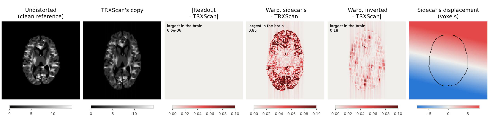
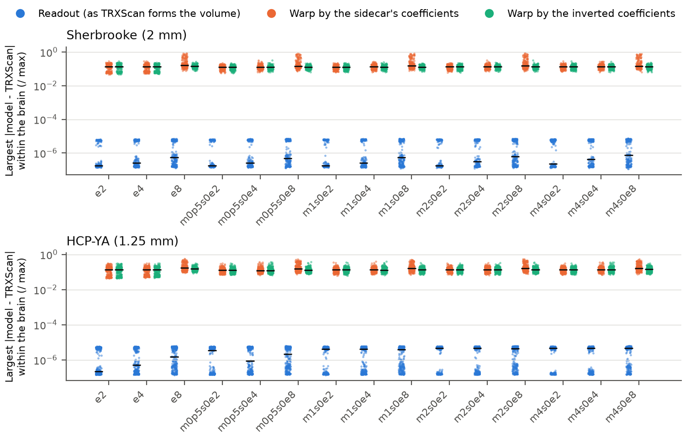
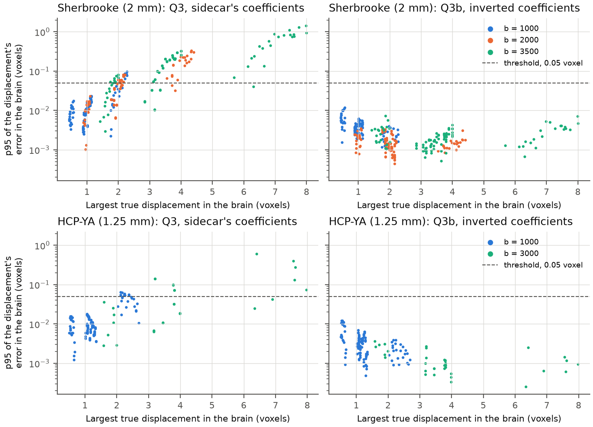

.. include:: ../links.rst

The eddy-current truth
======================
This experiment (`#618 <https://github.com/nipreps/nifreeze/issues/618>`__) asks
whether the displacement given in the sidecar of each eddy-current copy of the
phantoms can serve as the truth for scoring eddy-current correction, at the
phantoms' native resolution.
It also measures how close a correction by warping can get to the volumes that
TRXScan forms.
It involves no registration.

The question
------------
Each eddy-current copy of a phantom (:doc:`../phantoms`) comes with the
displacement of every volume along phase encoding, in closed form
(:class:`~nifreeze.analysis.sensitivity.Distortion`).
The displacement is a polynomial of degree 1,
*d* = *c*\ :sub:`0` + *c*\ :sub:`1` *x* + *c*\ :sub:`2` *y* + *c*\ :sub:`3` *z*.
Here *x*, *y* and *z* are the coordinates along the voxel axes, measured from the
field's center and divided by its radius.
In these phantoms the radius is the voxel size, so *x*, *y* and *z* count voxels
from the center.
The coefficients are in mm, and *c*\ :sub:`0` is zero.
TRXScan does not form the distorted volumes by moving voxels.
It forms them as an EPI readout does: each phase-encoding line accrues the phase
of the off-resonance field at the time the line is acquired.
A correction by registration works differently: it warps the volume, resampling
it at displaced points.
Every registration backend that *NiFreeze* could use corrects in this way.
The warp model of this experiment also scales the intensity by the Jacobian of the
displacement, so that no signal is created or lost, which not every backend does.

Three questions were registered before the run:

Q1, the readout model
    Does :class:`~nifreeze.analysis.sensitivity.Distortion`, forming each volume as
    the readout does from the sidecar's coefficients, reproduce TRXScan's volumes?
    This had been checked on the 4 mm phantom of continuous integration, within
    10⁻⁴ of the volume's maximum, but not at native resolution.
Q2, the warp model
    How far from TRXScan's volume is the undistorted volume, warped by the
    sidecar's displacement?
    This gap was registered as the floor of any correction by warping.
Q3, a fit without registration
    Which four coefficients bring the warped undistorted volume closest to
    TRXScan's volume, by least squares?
    How far is their displacement from the sidecar's?

The registered decision rule is as follows.
If the fit's displacement is within 0.05 voxel of the sidecar's on every fitted
volume of every copy, the sidecar's polynomial is the truth for scoring eddy
currents.
Within 0.05 voxel means that the 95th percentile of the difference over the brain
is below 0.05 voxel.
Otherwise, the fit is the truth, and the report says why.

Data
----
Both protocols of the phantom dataset are used, without noise: Sherbrooke, with
voxels of 2 mm, and HCP-YA, with voxels of 1.25 mm.
Phase encoding runs along the second voxel axis.
Each distorted copy is compared with an undistorted counterpart:

- The eddy-only copies ``e2``, ``e4`` and ``e8`` are compared with the clean
  reference.
- The combined copies ``m<m>s0e<e>`` are compared with the motion-only copy
  ``m<m>s0``, which has the same motions.
  The combined copies cover motions of *m* = 0.5, 1, 2 and 4 (a rotation of *m*
  degrees and a translation of *m* mm), and eddy currents of *e* = 2, 4 and 8
  voxels.
  TRXScan distorts each volume after moving it, in the scanner's frame, so the
  motion-only volume is the undistorted one.

Q1 and Q2 use every diffusion-weighted volume of the 15 copies.
Q3 uses the development volumes of five copies (``e2``, ``e4``, ``e8``, ``m1s0e4``
and ``m4s0e4``).
These are every third volume on Sherbrooke and every ninth on HCP-YA, starting from
the first.
On HCP-YA, every ninth volume misses the shell at b = 2000:

.. csv-table:: The diffusion-weighted volumes of each copy, and those fitted in Q3,
   per shell.
   :file: ../_static/registration/eddy-truth/eddy-truth-subset.csv
   :header-rows: 1
   :widths: auto

   The Sherbrooke volume of ``e8`` with the largest displacement (volume
   153, at b = 3500), on the axial slice through the center of the brain,
   in anterior-up orientation.
   Phase encoding runs from top to bottom.
   The first two panels share an intensity window.
   The next three show each model's absolute difference from TRXScan's volume,
   divided by its maximum, saturating at 0.1; the corner gives the largest value in
   the brain, over the whole volume.
   The readout model's difference is too small to show.
   The last panel is the sidecar's displacement in voxels, with the brain outlined.
   The *inverted* coefficients are introduced in `What the results show`_.

How the errors are measured
---------------------------
For Q1 and Q2, the model forms each volume from its undistorted counterpart.
The warp model resamples with cubic B-splines.
The formed volume is compared with TRXScan's volume, voxel by voxel, within the
brain mask.
Each absolute difference is divided by the largest intensity of TRXScan's volume.
Each volume reports the largest of these residuals and their 99th percentile (p99).

For Q3, the four coefficients of a volume are fitted by
:func:`scipy.optimize.least_squares`, with the Levenberg-Marquardt method,
starting from zero.
The residuals are the differences between the warped undistorted volume and
TRXScan's volume, divided by its largest intensity.
They are taken over the brain mask grown by as many voxels as the copy's largest
displacement, plus one, so that the fit also sees where the displaced signal lands.
The error of the fit is the difference between its displacement and the sidecar's,
at every voxel of the brain, in voxels along phase encoding.
Each volume reports the mean of that error, its 95th percentile (p95) and its
largest value.

Results
-------
**The readout model reproduces TRXScan's volumes (Q1).**
On every volume of every copy of both protocols, its largest residual within the
brain is at most 7.3 × 10⁻⁶ of the volume's maximum (the table below, row
*Readout*, column *Largest, worst*).

**Warped by the sidecar's coefficients, the volumes are far from TRXScan's (Q2).**
The largest residual within the brain has a median of 0.13 to 0.16 of the
volume's maximum, depending on the protocol and the magnitude.
Its worst value grows with the eddy currents: at 2 voxels it is 0.29 on Sherbrooke
and 0.36 on HCP-YA, and at 8 voxels it is 0.91 and 0.57.

.. csv-table:: Residuals of each model within the brain, relative to the volume's
   maximum: the median and the worst over the volumes, of each volume's largest
   residual and of its 99th percentile (p99). Each row pools the five copies with
   the same eddy currents (with and without motion). The rows of the inverted
   coefficients are post hoc (`What the results show`_).
   :file: ../_static/registration/eddy-truth/eddy-truth-models.csv
   :header-rows: 1
   :widths: auto

   The largest residual within the brain of every volume of every copy, by model
   (note the logarithmic scale). Black lines mark the medians.

**The fit does not find the sidecar's displacement (Q3), and the registered rule
fails.**
The 95th percentile of the fit's error is above 0.05 voxel on 131 of the 320 fitted
volumes of Sherbrooke and on 22 of the 150 of HCP-YA (the decision table below).
The error grows with the size of the displacement, and is largest at the highest
shell, whose volumes TRXScan distorts the most.

.. csv-table:: The fit's error, in voxels along phase encoding, per copy: the median
   and the worst over the fitted volumes of each volume's p95, how many volumes have
   a p95 above 0.05 voxel, and the largest difference between the fitted
   coefficients and those they are compared with, for the linear terms and for the
   constant term. The rows against the inverted coefficients are
   post hoc (`What the results show`_).
   :file: ../_static/registration/eddy-truth/eddy-truth-fit.csv
   :header-rows: 1
   :widths: auto

.. csv-table:: The decision rule, as registered (Q3) and applied post hoc to the
   inverted coefficients (Q3b).
   :file: ../_static/registration/eddy-truth/eddy-truth-decision.csv
   :header-rows: 1
   :widths: auto

   The p95 of the fit's error in every fitted volume, against the largest true
   displacement of that volume in the brain, colored by shell (note the
   logarithmic scale). Left: against the sidecar's coefficients, as registered.
   Right: against the inverted coefficients, post hoc. The dashed line is the
   threshold of the decision rule.

What the results show
---------------------
**The sidecar's coefficients and the best warp's differ by one factor per
volume.**
Q1 shows that the sidecar describes TRXScan's volumes, within 7.3 × 10⁻⁶ of the
volume's maximum, yet the warp that best matches them does not use the sidecar's
coefficients (Q3).
Looking at the fitted coefficients after the run, each volume's three fitted
linear coefficients were the sidecar's multiplied by one common factor, which
changed from volume to volume, and the fitted constant term was near zero.
In the volume shown above, for example, the sidecar's coefficients are 0, -0.0802,
-0.3556 and -0.0717 mm, and the fitted ones are -0.0021, -0.0681, -0.3017 and
-0.0609 mm: the linear terms are about 0.85 times the sidecar's.

**The two models take the displacement at different points.**
This explanation was posted on the issue
(`comment <https://github.com/nipreps/nifreeze/issues/618#issuecomment-6522680697>`__)
before the second run, so the analysis that follows is post hoc.
Let *d* be the sidecar's displacement, and *u* the world direction of the
phase-encoding voxel axis
(:attr:`~nifreeze.analysis.sensitivity.Distortion.direction`).

- The readout model takes the displacement at the source.
  The signal from a point *p* accrues the phase of the field at *p*, so it appears
  at *q* = *p* - *d*\ (*p*) *u*.
- The warp model takes the displacement at the destination.
  The warped volume shows at each point *q* what lies at *q* + *d*\ :sub:`w`\ (*q*) *u*.

For the warp to undo the readout, *q* + *d*\ :sub:`w`\ (*q*) *u* must be the source
*p* of every point *q*, so *d*\ :sub:`w`\ (*q*) = *d*\ (*p*).
Let *s* be the slope of *d* along phase encoding, in mm per mm, which is the same
everywhere for a field of degree 1.
Then *d*\ (*p*) = *d*\ (*q*) + *s* *d*\ (*p*), because *p* lies *d*\ (*p*) further
along phase encoding than *q*.
Solving gives *d*\ :sub:`w`\ (*q*) = *d*\ (*q*) / (1 - *s*).
The warp that undoes the readout therefore has the sidecar's coefficients divided
by 1 - *s*.
This report calls them the *inverted coefficients*.
In the shown volume, *s* = -0.178, so the inverted coefficients are the
sidecar's times 1 / 1.178 = 0.849.

The intensities match as well.
The readout spreads the signal of a length along phase encoding over 1 - *s* times
that length, so it scales the intensity by 1 / (1 - *s*).
The warp scales it by its Jacobian, 1 + *s* / (1 - *s*), which is the same.

The comment already reported that the first run's fits matched the inverted
coefficients.
The second run computed the inverted coefficients of every volume and added two
comparisons:

Q2b, the inverted warp
    The undistorted volume, warped by the inverted coefficients, compared with
    TRXScan's volume as in Q2.
Q3b, the fit against the inverted coefficients
    The fit's displacement compared with the inverted one, as in Q3.

It also recomputed Q1, Q2 and Q3, which match the first run exactly: the largest
difference over every column the first run wrote is zero (the table in
`Reproducing`_).

**Against the inverted coefficients, the fit is within the threshold on every
volume (Q3b).**
The worst p95 of the fit's error is 0.012 voxel on both protocols; measured from
the sidecar's coefficients, it was 1.4 voxels on Sherbrooke and 0.6 on HCP-YA (the
fit table).
The fitted linear coefficients differ from the inverted ones by at most 0.00069 mm
on Sherbrooke and 0.00023 mm on HCP-YA, against up to 0.085 and 0.015 mm from the
sidecar's.
The fit's constant term, which neither the sidecar's nor the inverted coefficients
have, reaches 0.006 mm and 0.0017 mm.
Q3b is not an independent test of the explanation: its fits are those of the first
run, which suggested the explanation.
It confirms on every fitted volume what the comment reported.

**The inverted warp still leaves a gap to TRXScan's volumes (Q2b).**
Q2b is the comparison that the first run had not made.
Inverting the coefficients removes most of the growth of the warp's worst residual
with the eddy currents: at 8 voxels, it drops from 0.91 to 0.32 on Sherbrooke, and
from 0.57 to 0.38 on HCP-YA, close to its values at 2 voxels (0.29 and 0.36).
The median of the largest residual barely changes, though: it is 0.13 to 0.14 at
every magnitude, as at 2 voxels, where the two warps give nearly the same
residuals.
The median p99 is 0.021 to 0.027.
That part of the gap comes neither from the displacement, which is now the right
one, nor from the scaling of the intensity, which matches the readout's (above).
It is a difference between forming a volume by the readout and warping it.
One explanation, not tested here, is that the readout forms the volume in k-space,
line by line, while the warp interpolates with cubic B-splines; the two differ most
where the phantom's intensity changes sharply.
The residuals in the figure of the inputs run in stripes along phase encoding,
which is consistent with that explanation but does not test it.

Consequences
------------
- **The sidecar is the truth of how TRXScan formed the volumes (Q1), with its
  displacement taken at the source point.**
  A correction by warping estimates a displacement at the destination.
  Scoring such a correction against the sidecar therefore needs one of the two
  converted first: for these fields of degree 1, the sidecar's coefficients
  divided by 1 - *s*.
  The registered rule compared the two conventions directly.
  It failed for that reason, not because the sidecar is wrong.
  Which truth the following experiments use is decided on review of this report
  (`#618 <https://github.com/nipreps/nifreeze/issues/618>`__).
- **The mapping on a combined copy has the opposite sign from the one
  registered.**
  The phantom moves first, so a reference point *x* lands at *y* = *M* *x* in the
  scanner.
  The field acts at *y*, in the scanner's frame: Q1 shows it on the combined
  copies, where the readout of the motion-only volume reproduces TRXScan's.
  The readout then shows the point at *T*\ (*x*) = *y* - *d*\ (*y*) *u*.
  The issue had written *y* + *d*\ (*y*) *u*.
  The sign follows from the derivation above, which holds for every copy: with the
  opposite sign, the fitted coefficients would be the sidecar's divided by
  -(1 + *s*), and they are not.
- **The gap that a correction by warping leaves with the right displacement is
  that of Q2b, not that of Q2.**
  Q2 also includes the error of warping with the wrong convention.
  The registration called Q2's gap the floor of a correction by warping.
  Neither gap is strictly a lower bound: a warp by a slightly different
  displacement might leave a smaller residual, and the fit, whose residuals are
  taken over a grown mask, does not settle that.
- **The inverse of a displacement of degree 2 is not a polynomial of degree 2.**
  It cannot be written as the coefficients of a
  :class:`~nifreeze.analysis.sensitivity.Distortion`.
  Experiments that distort with degree 2, as planned to test the robustness of
  eddy-current models, need to invert the displacement point by point: along each
  phase-encoding line, that means solving a quadratic equation.
- **The docstring of** :class:`~nifreeze.analysis.sensitivity.Distortion` says
  that a distorted volume shows at each point what lies *d* mm further along phase
  encoding.
  That holds for the warp model; in the readout model, the displacement is that of
  the source.
  Correcting that docstring belongs in a pull request of its own.

Open questions
--------------
- What makes the gap that the inverted warp leaves (Q2b)?
  Warping with band-limited interpolation along phase encoding, instead of cubic
  B-splines, would show whether the interpolation accounts for it.
- Does that gap bias a registration's estimate of the displacement?
  The fit of Q3 is itself a least-squares match over the brain, and the gap leaves
  it within 0.012 voxel of the inverted displacement (Q3b's worst p95), with a
  constant term of up to 0.006 mm that the inverted displacement does not have.
  A registration matches the images with another metric and other sampling, so
  whether its estimate is biased as little is for the experiments that register
  eddy-current copies (E0b and E3a in
  `#614 <https://github.com/nipreps/nifreeze/issues/614>`__).

Deviations from the registration
--------------------------------
- Q2b and Q3b were added after the first run, as described above.
  They were posted on the issue before the second run.
- The fit's residuals are taken over the brain mask grown by the copy's largest
  displacement plus one voxel, where the registration said within the mask.
  Both runs did so.
- The registered rule, when it fails, makes the fit the truth.
  This report instead proposes the sidecar, with its displacement taken at the
  source point, and leaves the choice to review, as the comment announced.
- The registration called Q2's gap the floor of a correction by warping; this
  report gives Q2's gap and argues for Q2b's, as the comment announced.
- The registered mapping on combined copies had the opposite sign
  (`Consequences`_).
- The runs used 12 processes, where the registration planned six, on the same
  CPUs: six physical cores and their hyper-threaded siblings.
  The volumes of one copy at a time were spread over the processes.
- HCP-YA needed more memory than registered: its largest process alone held
  20.9 GB (the table of the runs below), where the registration expected the run
  to stay under 12 GB.

Reproducing
-----------
The results are in the phantom dataset (:doc:`../phantoms`), under
``derivatives/registration/eddy-truth``.
``<protocol>.tsv`` has one row per volume of each copy, and ``<protocol>.json``
records the copies, the fitted volumes and the provenance of the run.
Each protocol ran twice, both times as a ``datalad run`` record of
``tools/registration/eddy_truth.py``, from the dataset's copy of *NiFreeze*.
The first run is the registered one.
The second, from the amended script, wrote the results this page reports, and
reproduces the first in every column the first wrote:

.. csv-table:: The first and the last run of each protocol (the dataset's commits),
   and the largest difference between their results.
   :file: ../_static/registration/eddy-truth/eddy-truth-reproduced.csv
   :header-rows: 1
   :widths: auto

.. csv-table:: The last run of each protocol: its run record, the *NiFreeze* commit
   it ran, its processes, its wall time, and the largest memory any of its
   processes held.
   :file: ../_static/registration/eddy-truth/eddy-truth-runs.csv
   :header-rows: 1
   :widths: auto

The commands of the last runs:

.. literalinclude:: ../_static/registration/eddy-truth/eddy-truth-command.txt
   :language: bash

The figures and tables of this page come from::

    uv run tools/registration/eddy_truth_figures.py --dataset <dataset> \
        --out docs/_static/registration/eddy-truth
