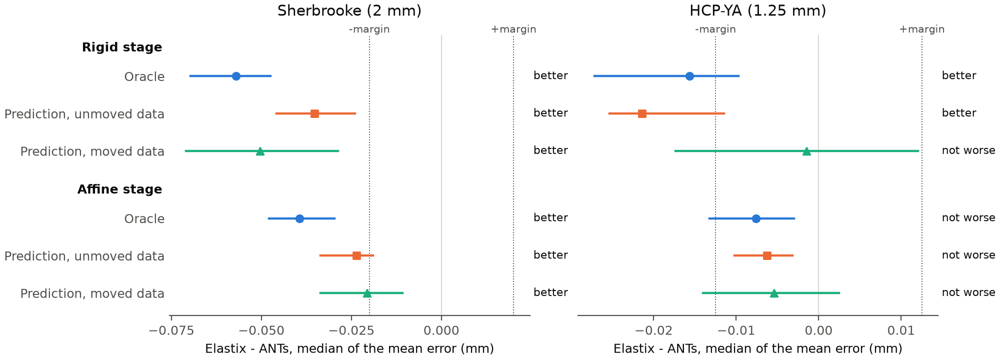
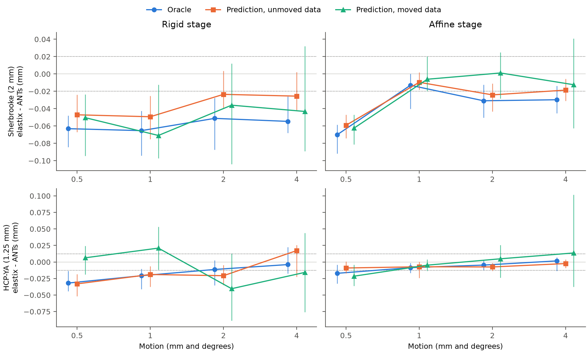

.. include:: ../links.rst

Elastix against ANTs, on held-out volumes
=========================================
*NiFreeze* registers each volume with ANTs, which reads the images from files on disk
and runs as a subprocess, through nipype.
Passing the images through the filesystem costs far more time than passing them in
memory, and elastix (`itk-elastix <https://github.com/InsightSoftwareConsortium/ITKElastix>`__)
takes them from memory, from Python
(`#590 <https://github.com/nipreps/nifreeze/issues/590>`__).
Elastix's settings map ANTs' component by component (:doc:`elastix-settings`), and on
the volumes those settings were developed on, elastix was ahead of ANTs.
This report tests that on volumes neither tool had registered before, in both stages
of registration, under rules posted before the run
(`#672 <https://github.com/nipreps/nifreeze/issues/672>`__).

The question
------------
Does elastix, with ANTs' settings mapped directly
(`#674 <https://github.com/nipreps/nifreeze/pull/674>`__), register the phantoms'
held-out volumes as accurately as today's ANTs path, and how fast?

Data
----
The phantoms (:doc:`../phantoms`)
    Sherbrooke (192 volumes at 2 mm) and HCP-YA (270 volumes at 1.25 mm), in the
    rigid-motion copies at 0.5, 1, 2 and 4 mm and degrees (motion seed 0, no eddy
    currents, noise 20261029): the copies of :doc:`elastix-settings`.
The held-out volumes
    The confirmation subset of ``tools/registration/experiments.py``, which the
    settings' experiments
    (`#670 <https://github.com/nipreps/nifreeze/issues/670>`__,
    `#675 <https://github.com/nipreps/nifreeze/issues/675>`__) never registered:
    Sherbrooke's 64 (every third volume, from index 1) and HCP-YA's 30 (every ninth,
    from index 4).
The fixed images
    Each volume is registered to three (:mod:`nifreeze.analysis.registration`): the
    noise-free volume at the true position (the oracle), and gqi-krr's held-out
    predictions from the unmoved and from the moved data.
    That makes (64 + 30) × 4 × 3 = 1,128 pairs per stage.

The two arms
------------
ANTs
    Today's path: ANTs 2.4.4 through nipype
    (:class:`~nifreeze.analysis.registration.AntsRegistration`).
Elastix
    The direct mapping, with the adaptive stochastic gradient descent, through
    itk-elastix 0.25.4 (:class:`~nifreeze.registration.elastix.Elastix`).

Each arm registers in two stages: the rigid default (``b0-to-b0_level0``), then the
affine second pass (``dwi-to-dwi_level1``), started from the same arm's rigid estimate
(ANTs takes it through
`#690 <https://github.com/nipreps/nifreeze/pull/690>`__).
Both arms get the same values (the moving volume's 12-bit window), one thread and
seed 12345.
At 1 mm, elastix registers every pair again, in both stages, to check that it repeats.

How the results are judged
--------------------------
The error of a registration is the mean, within the brain mask, of
:func:`~nifreeze.registration.utils.displacements_within_mask` between the estimated
and the true fixed-to-moving transform, in mm (:doc:`error-audit`).
Time is the wall time of one registration with one thread: ANTs' includes writing its
inputs to files, and elastix's its preprocessing in Python.
A registration that raises counts as failed, with the error of no correction.

Elastix is compared with ANTs in 12 cells (2 protocols × 2 stages × 3 fixed images)
with :func:`experiments.paired_comparison`, paired by volume and motion and resampled
within motions.
The margin is 0.01 voxel (0.02 mm on Sherbrooke, 0.0125 mm on HCP-YA), and the
interval of the median difference gives "better", "worse", "not worse" or
"inconclusive".
The working hypothesis
(`posted on #672 <https://github.com/nipreps/nifreeze/issues/672#issuecomment-7011344529>`__)
set three rules:

Accurate
    In every cell, elastix is "better" or "not worse"; none of its registrations fails;
    and, in each protocol and stage, it lands further from the truth than no correction
    no more often than ANTs.
Repeatable
    Registered again, elastix returns every estimate bit for bit.
Faster
    In each protocol and stage, its median time is below ANTs'.

If all three hold, the estimator takes backends
(`#667 <https://github.com/nipreps/nifreeze/issues/667>`__), and elastix becomes its
default wherever ``itk-elastix`` is installed.
The tails (the difference of the 95th percentiles), the comparisons by motion and the
maximum errors are reported, but not used in the decision.
On the development volumes, the interval of the tail on the prediction from the moved
data was 23 to 66 times as wide as the margin, so no tool could have met a rule on it.

Results
-------
Elastix meets all three rules.

Accuracy
^^^^^^^^
Elastix is better than ANTs in 8 of the 12 cells and not worse in the other 4, all
four on HCP-YA.
The median difference is negative in all 12.
In two of HCP-YA's "not worse" cells (the affine stage, on the oracle and on the
prediction from the unmoved data), the whole interval is below zero, but the median is
not below the margin, which "better" requires.
The cell that was inconclusive on the development volumes (HCP-YA's rigid stage on
the prediction from the moved data) is "not worse" here, with its upper bound just
under the margin.

   Elastix minus ANTs, the median difference of the mean error and its 95% interval,
   in each cell; 1,128 pairs per stage.
   Points left of zero are cells where elastix lands closer to the truth.
   "Better" needs the interval below zero and the median left of the margin;
   "not worse" needs the interval left of the right margin.

.. csv-table:: Elastix minus ANTs, by protocol, stage and fixed image: the median
   difference of the mean error and the difference of the 95th percentiles (mm), each
   with its 95% interval, Wilcoxon's p value Holm-adjusted across the 12 cells, and the
   verdict.
   :file: ../_static/registration/elastix-accuracy/elastix-accuracy-comparisons.csv
   :header-rows: 1
   :widths: auto

Failures and repeatability
^^^^^^^^^^^^^^^^^^^^^^^^^^
No registration failed, in either arm.
Of each arm's 2,256 registrations, ANTs ended further from the truth than no correction
twice (both on Sherbrooke, in the rigid stage), and elastix never.
Registered again at 1 mm, elastix returned all 564 estimates bit for bit.

Time
^^^^
Elastix takes 0.58 (Sherbrooke) and 0.64 (HCP-YA) of ANTs' time in the rigid stage,
and 0.39 and 0.31 in the affine stage.

.. csv-table:: Median seconds per registration, with one thread.
   :file: ../_static/registration/elastix-accuracy/elastix-accuracy-time.csv
   :header-rows: 1
   :widths: auto

Reported, not used in the decision
^^^^^^^^^^^^^^^^^^^^^^^^^^^^^^^^^^
On the oracle and the prediction from the unmoved data, elastix's 95th percentile is
lower than ANTs' in all 8 cells, and the interval excludes zero in 5.
On the prediction from the moved data, the intervals of the tail are again too wide to
tell.
Elastix's median maximum error is below ANTs' in all 12 cells.

By motion, elastix's lead comes mostly from the smaller motions.
On HCP-YA at 4 mm, the median difference is positive in 3 of 6 cells, each "not worse"
or inconclusive on its 30 volumes; on Sherbrooke at 4 mm, it is negative in all 6.

   Elastix minus ANTs, the median difference of the mean error at each motion, with its
   95% interval (64 volumes per motion on Sherbrooke, 30 on HCP-YA).
   The dotted lines are the margin on either side of zero.
   On the prediction from the moved data, the intervals widen with the motion, as that
   target's own error does.

.. csv-table:: Elastix minus ANTs at each motion: the median difference of the mean
   error (mm) and its verdict on that motion's volumes.
   :file: ../_static/registration/elastix-accuracy/elastix-accuracy-motion.csv
   :header-rows: 1
   :widths: auto

.. csv-table:: Median mean and maximum errors (mm) of each arm.
   :file: ../_static/registration/elastix-accuracy/elastix-accuracy-errors.csv
   :header-rows: 1
   :widths: auto

.. csv-table:: For scale: the median mean error (mm) of no correction, at each motion.
   :file: ../_static/registration/elastix-accuracy/elastix-accuracy-none.csv
   :header-rows: 1
   :widths: auto

Consequences
------------
* By the rules of the working hypothesis, the estimator takes backends
  (`#667 <https://github.com/nipreps/nifreeze/issues/667>`__), and elastix becomes its
  default wherever ``itk-elastix`` is installed.
  ANTs stays the default without it.
* Both stages switch: the rigid default and the affine second pass.

Open questions
--------------
* Does elastix's lead hold beyond the phantoms' motions?
  It shrinks with the motion on HCP-YA, and the phantoms stop at 4 mm and 4°.
  Beyond them only the checks on real images speak (:doc:`elastix-settings`), and they
  were added after the fact: the direct mapping never failed under large rotations of
  the suite's b=0 images, and on Stanford HARDI at 4 and 8 mm it ended closer to the
  truth than ANTs on the prediction from the moved data.
* The affine second pass was mapped, not tuned.

Deviations from the registration
--------------------------------
None from the rules.
The rules were set on the development volumes (:doc:`elastix-settings`), as the
working hypothesis says, and the held-out volumes were registered once.

Reproducing
-----------
The run was made outside the phantom dataset, which another branch held at the time,
and without a ``datalad run`` record.
The files it read last changed in the dataset's commit 6619f01 (2026-10-30), and the
dataset stood at the same commit at the start and the end of each protocol.
The run's *NiFreeze* commit, clean, was 4c1f1344; it took 30 min for Sherbrooke and
64 min for HCP-YA, with 6 workers on 6 physical cores.
From the repository's root::

    uv run tools/registration/elastix_accuracy.py --dataset <dataset> \
        --protocol sherbrooke --out <results> --jobs 6
    uv run tools/registration/elastix_accuracy.py --dataset <dataset> \
        --protocol hcpya --out <results> --jobs 6

The decision, and the figures and tables of this page, come from::

    uv run tools/registration/elastix_accuracy_figures.py --results <results> \
        --out docs/_static/registration/elastix-accuracy --figures
