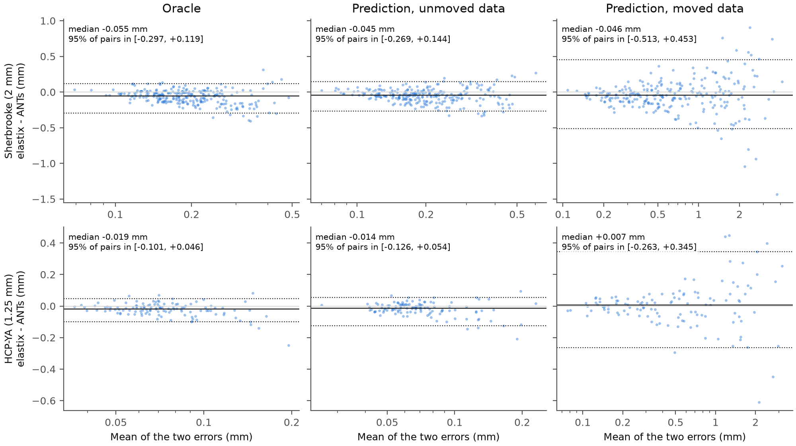
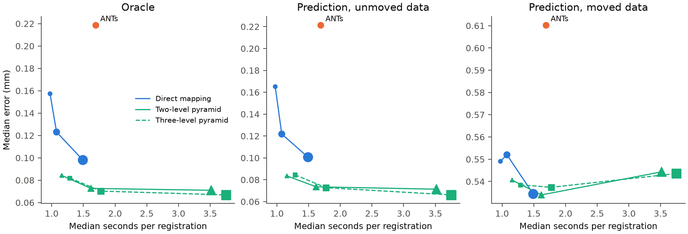

.. include:: ../links.rst

Elastix's settings, mapped from ANTs
====================================
*NiFreeze* registers each volume with ANTs, which reads the images from files on disk
and runs as a subprocess, through nipype.
Passing the images through the filesystem costs far more time than passing them in
memory, and elastix (`itk-elastix <https://github.com/InsightSoftwareConsortium/ITKElastix>`__)
takes them from memory, from Python
(`#590 <https://github.com/nipreps/nifreeze/issues/590>`__).
This report gathers the experiments behind elastix's settings in *NiFreeze*:
how ANTs' default settings were mapped onto elastix's components
(`#670 <https://github.com/nipreps/nifreeze/issues/670>`__),
whether a multi-resolution pyramid or more iterations improve on that direct
mapping (`#675 <https://github.com/nipreps/nifreeze/issues/675>`__),
and two checks on real images.

Throughout, *the direct mapping* names elastix's settings that reproduce ANTs'
schedule component by component: it is a rigid (six degrees of freedom) registration,
as ANTs' is.

The questions
-------------
1. Mapped component by component from ANTs' rigid default (``b0-to-b0_level0``) and
   affine second pass (``dwi-to-dwi_level1``), does elastix register the phantoms as
   accurately as ANTs, and how fast?
   (`#670 <https://github.com/nipreps/nifreeze/issues/670>`__)
2. Do a multi-resolution pyramid, more iterations or the preconditioned optimizer
   widen elastix's lead over ANTs?
   (`#675 <https://github.com/nipreps/nifreeze/issues/675>`__)
3. Do the answers hold on real images: b=0 images under large rotations, and
   diffusion-weighted volumes with their real noise?

The direct mapping
------------------
Each ANTs stage becomes one elastix parameter map
(``src/nifreeze/registration/config/elastix/``).
The values were read from the sources of ANTs 2.4.4, ITK 5.3.0 and elastix 5c71a233
(the build of itk-elastix 0.25.4), which the pull request
(`#674 <https://github.com/nipreps/nifreeze/pull/674>`__) cites by file and line.

.. list-table:: ANTs' components and their elastix counterparts.
   :header-rows: 1
   :widths: auto

   * - ANTs
     - Elastix
   * - ``Rigid``, ``Affine``
     - ``EulerTransform``, ``AffineTransform``; ``AutomaticScalesEstimation``; no automatic
       initialization
   * - ``GC`` (global correlation)
     - ``AdvancedNormalizedCorrelation``
   * - ``Mattes``, 32 bins
     - ``AdvancedMattesMutualInformation``, 32 bins
   * - Shrink factor *k*, which shrinks only the virtual grid that ANTs samples
     - Full-resolution images; the samples thinned by *k*\ :sup:`3`
   * - Smoothing sigma in voxels
     - ``ImagePyramidSmoothingSchedule`` in mm (the sigma times the voxel size)
   * - ``Random`` sampling of a fraction *p*, once per level
     - ``RandomCoordinate``: *p* times the mask's voxels over *k*\ :sup:`3`, seeded
   * - ``Rigid[step]``, conjugate-gradient line search
     - ``AdaptiveStochasticGradientDescent`` with ANTs' step (12 and 1.96 mm) as
       ``MaximumStepLength``
   * - Winsorizing and histogram matching
     - The same, in the backend, with ANTs' parameters
   * - Fixed-image mask
     - ``fixed_mask``, not eroded (``ErodeMask false``)

ANTs' optimizer has no counterpart in elastix, so #670 compared two:
elastix's ``ConjugateGradient`` with Polak-Ribière directions, as ANTs' line search
uses, and the adaptive stochastic gradient descent, elastix's default.

Data
----
Phantoms (:doc:`../phantoms`)
    The development volumes of Sherbrooke (64, every third of 192) and HCP-YA (30,
    every ninth of 270), in the rigid-motion copies at 0.5, 1, 2 and 4 mm and degrees
    (motion seed 0, no eddy currents, noise 20261029).
    Each volume is registered to three fixed images: the noise-free volume at the true
    position (the oracle), and gqi-krr's held-out predictions from the unmoved and from
    the moved data (:mod:`nifreeze.analysis.registration`).
    #670 runs both protocols and both stages (the affine second pass starts from the
    same tool's rigid estimate): 1,128 pairs.
    #675 runs Sherbrooke's rigid stage only, as #614 tunes: 768 pairs.
The suite's real b=0 images
    The b=0 averages of ``hcph`` and ``dwi`` in the test data, each registered to
    itself resampled (cubic) under the 216 known motions of ``test_ANTs_config_b0``
    (0, 0.1 or 0.3 rad about each axis, 0 or 1 mm along each), and ``dwi.h5``'s b=0
    under the 7 motions of ``dwi_motion.h5``.
    The two images of each pair differ in neither noise nor contrast.
Stanford HARDI
    DIPY's preprocessed Stanford HARDI (150 volumes at b=2000, 2 mm), taken as aligned.
    Copies move every volume by :func:`~nifreeze.testing.perturbations.perturbation_plan`
    (a random axis and direction per volume, seed 0, about the brain's centroid) at 1,
    2, 4 and 8 mm and degrees, through :func:`~nifreeze.testing.perturbations.perturb`,
    with an unmoved copy as the control.
    Every fifth volume (30) is registered to the same three kinds of fixed image; the
    oracle is the volume itself, with the same noise.

Every registration runs with one thread and seed 12345, and gets the values ANTs reads
today: the 12-bit window of the moving volume.

How the errors are measured
---------------------------
The error of a registration is the mean, within the brain mask, of
:func:`~nifreeze.registration.utils.displacements_within_mask` between the estimated
and the true fixed-to-moving transform, in mm (:doc:`error-audit`).
Two settings are compared with :func:`experiments.paired_comparison`, paired by
volume and motion and resampled within motions, with a margin of 0.01 voxel: the
interval of the median difference gives "better", "worse", "not worse" or
"inconclusive".
Time is the wall time of one registration, with one thread: for ANTs it includes
writing the inputs, for elastix its preprocessing in Python.

Results
-------

The direct mapping against ANTs
^^^^^^^^^^^^^^^^^^^^^^^^^^^^^^^
With the adaptive optimizer, the direct mapping is better than ANTs in 8 of 12
comparisons, not worse in 3, and inconclusive in 1 (HCP-YA's prediction from the moved
data, rigid stage).
The conjugate-gradient variant is never better than ANTs, so it was dropped.

.. csv-table:: Elastix minus ANTs, median difference of the mean error [95% interval]
   and the verdict, by protocol, fixed image and stage; 1,128 pairs.
   :file: ../_static/registration/elastix-settings/elastix-settings-mapping.csv
   :header-rows: 1
   :widths: auto

.. csv-table:: Median seconds per registration.
   :file: ../_static/registration/elastix-settings/elastix-settings-mapping-time.csv
   :header-rows: 1
   :widths: auto

   The direct mapping (adaptive) against ANTs, rigid stage: each pair's difference of
   mean errors against their mean.
   The solid line is the median difference and the dotted lines hold 95% of the pairs.
   Points below zero are pairs where elastix lands closer to the truth.
   The spread grows with the prediction from the moved data, whose own error both tools
   follow.

The video plays the 64 development volumes of Sherbrooke's 4 mm copy, registered to
the prediction from the moved data, in acquisition order.
Each row is a cut through the centre of the brain, and the red lines are the target's
edges, drawn over the sample before registration and after each tool's estimate.
Below, the timeline gives each tool's mean error per volume.

.. raw:: html

   <video controls loop muted playsinline preload="metadata" style="width: 100%"
     src="../_static/registration/elastix-settings/elastix-settings-series-sherbrooke-m4-moved.mp4">
   </video>

Pyramids and iterations
^^^^^^^^^^^^^^^^^^^^^^^
#675 crossed two factors on the direct mapping, with the adaptive optimizer:

The schedule
    The direct mapping's two levels, on full-resolution images (the shrink factors
    only thin the samples); a pyramid of two levels, rescaled by 2 and 1; or of three,
    rescaled by 4, 2 and 1.
    The pyramids smooth by half the rescale factor (voxels), except at full resolution.
    Each level samples ANTs' fraction of its own grid's mask voxels, so the pyramids'
    last level draws 8 times the direct mapping's samples.
The iterations
    1, 4 or 16 times the direct mapping's (20 at each level but the last, 10 there).

A pilot took the preconditioned stochastic gradient descent out of the design: of 144
registrations under four of its settings, 96 ended further from the truth than no
registration, and 9 failed.

Every configuration is better than the direct mapping on the oracle and on the
prediction from the unmoved data, in the median and at the 95th percentile, and none
is worse on the prediction from the moved data.
The two-level pyramid at 1x iterations is the only one better on all three.
Every configuration is better than ANTs on all three, and all but those at 16x
iterations, and the three-level pyramid at 4x, are faster than ANTs.

.. csv-table:: Each configuration minus the direct mapping (1x iterations), median
   difference of the mean error [95% interval] and the verdict; 256 pairs per cell.
   :file: ../_static/registration/elastix-settings/elastix-settings-pyramids-direct.csv
   :header-rows: 1
   :widths: auto

.. csv-table:: Each configuration minus ANTs.
   :file: ../_static/registration/elastix-settings/elastix-settings-pyramids-ants.csv
   :header-rows: 1
   :widths: auto

.. csv-table:: The 95th percentile of the error, and the registrations that failed (none).
   :file: ../_static/registration/elastix-settings/elastix-settings-pyramids-tail.csv
   :header-rows: 1
   :widths: auto

   Median error against median time, by fixed image.
   The marker's size gives the iterations (1x, 4x, 16x).
   On the oracle and on the prediction from the unmoved data, the pyramids reach at 1x
   what the direct mapping does not reach at 16x; on the prediction from the moved
   data, every configuration lands within 0.02 mm of the others.

Real images
^^^^^^^^^^^
On the suite's b=0 images, the two-level pyramid fails under large rotations: 74 of 439
registrations end at a mean error of 0.6 voxel or more (the suite's criterion), all
above about 10 mm of mean displacement, a range the phantoms never reach.
Its coarsest level is smoothed by 1 voxel at half resolution, against 2.71 voxels for
the direct mapping's first level and 2 voxels at a quarter of the resolution for the
three-level pyramid.
The direct mapping and the three-level pyramid never fail.

.. csv-table:: The suite's b=0 images under known motions: the mean error per
   registration, and the registrations at 0.6 voxel or more.
   :file: ../_static/registration/elastix-settings/elastix-settings-b0.csv
   :header-rows: 1
   :widths: auto

On Stanford HARDI, at motions up to 2 mm and degrees, ANTs, the direct mapping and the
three-level pyramid are within 0.015 mm of each other on both predictions, every
comparison "not worse" or close to it.
The unmoved copy sets the floor: every tool's error is 0.15 to 0.16 mm without any
motion, from the data's own misalignment or the prediction's bias, so the real images
cannot separate the tools below it.
At 4 and 8 mm, on the prediction from the moved data, every tool ends 2 to 5 mm from
the truth; there the direct mapping is better than ANTs (by 0.78 mm at 8 mm) and than
the three-level pyramid (by 0.38 mm).

.. csv-table:: Stanford HARDI: the median of the mean error (mm) by fixed image and
   motion; 30 volumes each.
   :file: ../_static/registration/elastix-settings/elastix-settings-stanford.csv
   :header-rows: 1
   :widths: auto

.. csv-table:: Stanford HARDI: paired comparisons by motion; 30 volumes each.
   :file: ../_static/registration/elastix-settings/elastix-settings-stanford-comparisons.csv
   :header-rows: 1
   :widths: auto

What the results show
---------------------
* The direct mapping, with the adaptive optimizer, is at least as accurate as ANTs on
  the phantoms (better in 8 of 12 comparisons) at 1.6 to 3.3 times its speed, never
  failed on any of the images above, and is never worse than ANTs on real
  diffusion-weighted volumes.
* A real pyramid is more precise where the target is clean (the phantoms' oracle and
  unmoved prediction, the b=0 copies), by 0.07 to 0.08 mm on the phantoms.
  On real diffusion-weighted volumes its gain is below what the data can resolve, and
  where the target is corrupted by a large motion it follows the corruption further
  than the direct mapping does.
* The capture range depends on the coarsest level: the two-level pyramid, whose
  coarsest level is the least smoothed, is the only setting that fails.
* More iterations improve the clean targets and worsen the tail on the prediction from
  the moved data: the closer a registration fits a corrupted target, the further it can
  land from the truth.

Consequences
------------
* The direct mapping, with the adaptive optimizer, is elastix's rigid default and
  affine second pass in *NiFreeze*
  (`#674 <https://github.com/nipreps/nifreeze/pull/674>`__).
  ANTs stays the estimator's default until elastix is tested against it on the
  held-out volumes (`#672 <https://github.com/nipreps/nifreeze/issues/672>`__), which
  elastix passed (:doc:`elastix-accuracy`).
* The pyramids are kept as candidates for a schedule that registers in passes:
  a coarse level across every volume, a refit of the model, then a finer level, so that
  the finer level registers to a cleaner target.

Open questions
--------------
* Do coarse-to-fine passes across all volumes, with the model refitted between them,
  beat one rigid pass per volume?
  The motions must include large rotations, and the test must include real
  diffusion-weighted volumes.
* Why does the preconditioned stochastic gradient descent diverge on these images?
  Its first steps at a level jump (the norm of the search direction from 6 to 740 in
  one failed case) under every setting tried.
* The affine second pass was mapped, not tuned.

Deviations from the registration
--------------------------------
* #670's decision rule was applied without a working hypothesis posted first, so its
  verdicts are exploratory; #672 tests on the held-out volumes.
* #675's working hypothesis added a tail rule (the upper bound of the 95th-percentile
  difference below the margin on every fixed image).
  On the prediction from the moved data its interval is 0.6 to 0.7 mm wide, against a
  margin of 0.02 mm, so no configuration could meet it, and by the rule as registered
  every configuration failed.
  The results above read the medians and the tails as measured.
* The pilot dropped the preconditioned optimizer before the run, as posted on #675.
* The checks on real images were added after #675's results (*post hoc*).

Reproducing
-----------
The runs were made outside the phantom dataset, which another branch held at the time,
and without ``datalad run`` records.
Each result folder keeps the script that wrote it, and each run its *NiFreeze*
commit, clean:

* #670: ``battery.py`` at 2ebb5471, through an elastix probe that the backend
  (`#676 <https://github.com/nipreps/nifreeze/pull/676>`__) reproduces bit for bit.
* #675: ``tools/registration/elastix_tuning.py`` at 9001a627.
* The real images: two scripts at 9001a627, now
  ``tools/registration/elastix_real_b0.py`` and ``tools/registration/elastix_real_dwi.py``,
  which reproduce their tables (every error identical; only the times differ).

The commands of the runs, from the repository's root and with 6 workers on 6 physical
cores::

    uv run tools/registration/elastix_tuning.py --dataset <dataset> \
        --out <results>/elastix-tuning --jobs 6
    uv run tools/registration/elastix_real_b0.py --arms ants t-x1 p2-x1 \
        --jobs 6 --out <results>/real-b0
    uv run tools/registration/elastix_real_b0.py --arms p3-x1 p3-x4 --name real-data-p3 \
        --jobs 6 --out <results>/real-b0
    uv run tools/registration/elastix_real_dwi.py --jobs 6 --out <results>/stanford-hardi

The figures and tables of this page come from::

    uv run tools/registration/elastix_settings_figures.py --dataset <dataset> \
        --mapping <results>/elastix-mapping --tuning <results>/elastix-tuning \
        --real <results> --out docs/_static/registration/elastix-settings
