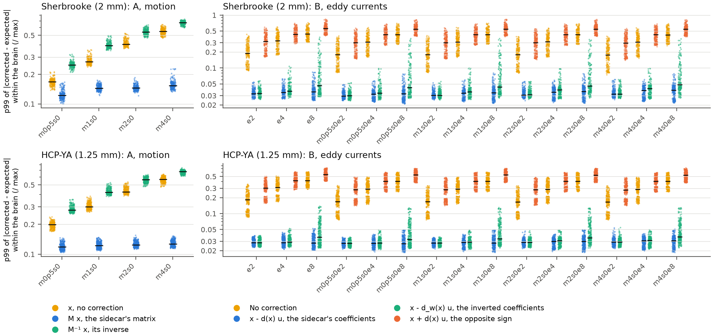
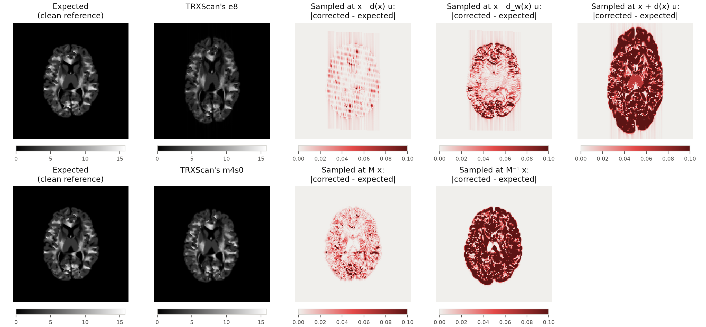

.. include:: ../links.rst

The error audit
===============
This audit (`#626 <https://github.com/nipreps/nifreeze/issues/626>`__) checks
what the registration experiments count as error: which transform each compares
with the phantoms' truth, in which direction, at which points, and within which
mask.
It was prompted by the eddy-current truth (:doc:`eddy-truth`), whose registered
decision rule compared two maps that point in opposite directions.
It involves no registration.

The question
------------
*NiFreeze* registers each volume to a model's prediction of it
(:meth:`~nifreeze.estimator.Estimator.run`).
The prediction is the fixed image, on the reference's grid, and the volume is the
moving image.
ANTs then returns the transform that maps each point *x* of the fixed image to the
point of the moving image that holds the same tissue.
``test_ANTs_config_b0`` (``test/test_registration.py``) checks that direction on a
synthetic rigid motion, and the convention tests of
`#619 <https://github.com/nipreps/nifreeze/issues/619>`__ (not merged yet) check it
on three kinds of grid.
Realignment then samples the volume at those points.

The truth of a phantom must therefore give, for each point *x* of the reference,
where TRXScan put that point's signal in the perturbed copy:

Motion
    The sidecar's matrices move the phantom: the point *x* lands at *M* *x*
    (``grid_moved`` in ``tools/phantoms/phantom.py``, and the docstring of
    :func:`~nifreeze.testing.perturbations.rigid_motion`).
Eddy currents
    The readout puts the signal from *x* at *x* - *d*\ (*x*) *u*, with *d* the
    sidecar's displacement and *u* the direction of phase encoding
    (:doc:`eddy-truth`).
Both
    The phantom moves first, and the field acts in the scanner's frame, so *x*
    lands at *y* - *d*\ (*y*) *u*, with *y* = *M* *x*.

The inverse map, from each point of the copy back to the reference, is what a model
needs when it warps the reference to imitate the copy, as the eddy-current truth's
Q2 and Q3 did.
For a linear field, its coefficients are the sidecar's divided by 1 - *s*, with *s*
the slope of the displacement along phase encoding (the *inverted coefficients*).

What the code computes
----------------------
**Every registration error reported so far compares two maps of the fixed image's
points.**
:func:`~nifreeze.registration.utils.displacements_within_mask` takes the center *x*
of every voxel of the reference's brain mask, in world coordinates, and returns
the distance between the estimate's image of *x* and the truth's.
R1, the registration floor and the harness report the mean and the largest of these
distances per volume; the end-to-end gates use the largest.
The points are those of the fixed image, the domain of both maps, and the mask is
where the brain lies in the fixed image.
These use it:

- :func:`~nifreeze.analysis.registration.registration_accuracy`, behind R1
  (`#584 <https://github.com/nipreps/nifreeze/issues/584>`__);
- ``tools/registration/floor.py``, behind the registration floor
  (`#609 <https://github.com/nipreps/nifreeze/issues/609>`__,
  :doc:`../registration`);
- the gates of ``test/test_e2e_motion.py``, which also remove the transform shared
  by all the estimates, composed before the truth (the estimate is the truth
  applied after that shared transform);
- ``errors`` in ``tools/registration/harness.py``, for every experiment from here on.

**The sensitivity ladder uses no transform.**
:func:`~nifreeze.analysis.sensitivity.sensitivity` compares each held-out
prediction from a perturbed copy with the prediction of the same volume from the
reference, on the same grid.

**The phantoms' b-vectors rotate the right way.**
TRXScan applies the components of its gradient tables along the voxel axes
(:doc:`../phantoms`).
:func:`~nifreeze.data.dmri.utils.transform_fsl_bvec` turns a b-vector by the motion
conjugated with the grid's affine, which is right for tables along the voxel axes,
without FSL's flip.
The phantoms are that case.
Tables loaded from FSL's ``.bvec`` files on grids with a positive determinant are
not, as `#620 <https://github.com/nipreps/nifreeze/issues/620>`__ reports.

The checks
----------
The checks test the truths above against the volumes TRXScan formed, without any
registration.
Each samples a perturbed copy at the points that a candidate map gives, with cubic
B-splines, and scales the samples by the Jacobian of that map.
The result is compared with the volume that the correction should then reproduce,
voxel by voxel, within the reference's brain mask: the frame in which a corrected
volume lies.
Each absolute difference is divided by the largest intensity of the volume compared
against.
Each volume reports the largest of these residuals and their 99th percentile (p99).
Every diffusion-weighted volume of every copy of both protocols is checked, without
noise.

A, the motion
    Each motion-only copy (``m0p5s0`` to ``m4s0``), sampled at *M* *x*, at
    *M*\ :sup:`-1` *x*, and at *x* (no correction), against the clean reference.
B, the eddy currents
    Each eddy-only copy, sampled at *x* - *d*\ (*x*) *u* (the sidecar's
    coefficients), at *x* - *d*\ :sub:`w`\ (*x*) *u* (the inverted coefficients,
    in the readout's direction, as the first version of :doc:`eddy-truth` proposed
    for scoring), at *x* + *d*\ (*x*) *u* (the opposite sign) and at *x*, against
    the undistorted volume.
    The combined copies are checked twice: the eddy currents alone, sampled at
    *y* - *d*\ (*y*) *u* and its alternatives for every point *y* of the brain mask,
    against the motion-only copy; and the whole mapping, sampled at
    *M* *x* - *d*\ (*M* *x*) *u* and its alternatives, against the clean reference.
C, the domain of the eddy-current truth's residuals
    Q1 (the readout) and Q2b (the inverted warp) of :doc:`eddy-truth` again, within
    the brain mask as there, within the mask grown by the copy's largest
    displacement plus one voxel, and over the whole volume.

The decision rule, registered before the run:

- A confirms the motion truth if *M* *x* gives a smaller residual than
  *M*\ :sup:`-1` *x* and than *x* on every volume of every copy.
- B confirms that the sidecar's coefficients are the truth for scoring a correction
  that maps the fixed image into the moving one, with no conversion, if they give a
  smaller residual than the opposite sign on every volume, and than the inverted
  coefficients on every volume where the two displacements differ by more than
  0.1 voxel within the mask.
- If the residuals of C over the grown mask or the whole volume exceed those within
  the mask, the eddy-current truth reports them instead, and says why.

Results
-------
.. csv-table:: The decision rule, applied to the 99th percentile and to the largest
   residual of each volume. Where a candidate is not below the others, the excess is
   how far its residual lies above the lowest of theirs, relative to the volume's
   maximum.
   :file: ../_static/registration/error-audit/error-audit-decision.csv
   :header-rows: 1
   :widths: auto

   The p99 of the residual of every volume, by copy and candidate map (note the
   logarithmic scale). Black lines mark the medians. Left (A): the motion-only
   copies, against the clean reference. Right (B): the eddy currents alone, against
   the undistorted volume (the clean reference, or the motion-only copy for the
   combined copies).

**By the p99 of the residual, the sidecar's matrices are the motion truth (A).**
Sampled at *M* *x*, every motion-only copy comes closer to the clean reference than
sampled at *M*\ :sup:`-1` *x* or left as it is, on every volume, by the p99 of the
residual (the decision table).
The residual that *M* *x* leaves hardly grows with the motion: its median p99 is
0.122 at 0.5° and 0.154 at 4° on Sherbrooke, and 0.118 and 0.127 on HCP-YA.
Without correction it grows from 0.168 to 0.549 on Sherbrooke and from 0.199 to
0.568 on HCP-YA, and with *M*\ :sup:`-1` from 0.250 to 0.674 and from 0.280 to
0.680 (the motion table).
By the largest residual, the rule fails: *M* *x* leaves a larger residual than one
of the others on 258 of the 768 Sherbrooke volumes and on 39 of the 1,080 HCP-YA
volumes.
The median of each volume's largest residual after *M* *x* is 0.71 to 0.76 of the
volume's maximum at every motion of both protocols, 0.5° included, close to what is
left without correction at 0.5° (0.75 on Sherbrooke and 0.79 on HCP-YA).
Its worst value reaches 0.96 to 1.01.

.. csv-table:: Check A, per motion-only copy: the median p99 of each candidate, the
   worst p99 of *M* *x*, the median of each candidate's largest residual, and the
   worst largest residual of *M* *x*.
   :file: ../_static/registration/error-audit/error-audit-motion.csv
   :header-rows: 1
   :widths: auto

**By the p99 of the residual, the sidecar's coefficients are the eddy-current truth
of a correction (B).**
Sampled at *x* - *d*\ (*x*) *u*, every eddy-current copy comes closer to the volume
before its eddy currents than sampled at *x* + *d*\ (*x*) *u*, on every volume.
It also comes closer than sampled with the inverted coefficients, on every volume
where the two displacements differ by more than 0.1 voxel, by the p99 of the
residual.
The median p99 of the sidecar's coefficients is 0.031 to 0.035 at every magnitude
on Sherbrooke, and 0.028 to 0.029 on HCP-YA.
That of the inverted coefficients grows from 2 voxels to 8, from 0.031 to 0.045 on
Sherbrooke and from 0.028 to 0.034 on HCP-YA.
Their worst p99 is 0.061 at 2 voxels and 0.386 at 8 on Sherbrooke, and 0.055 and
0.139 on HCP-YA (the eddy-current table).
The two displacements differ by more than 0.1 voxel on none of the volumes at 2
voxels, so that comparison rests on the copies at 4 and 8 voxels (the eddy-current
table).
Where they differ less, the two candidates are equivalent: the inverted coefficients
come out lower on 500 of 2,040 such volumes of Sherbrooke and on 981 of 3,080 of
HCP-YA, by at most 0.001 of the maximum (the decision table, rows *not in the
rule*).
By the largest residual, the inverted coefficients come out lower on 108 of the 840
Sherbrooke volumes where the two differ, and on 168 of the 970 HCP-YA volumes, by a
median of 0.010 of the volume's maximum and at most 0.041 and 0.048.

.. csv-table:: Check B, the eddy currents alone: per magnitude, over the eddy-only
   copy and the four combined copies, the median p99 of each candidate, the worst
   p99 and largest residual of the sidecar's and the inverted coefficients, and how
   many volumes have displacements that differ by more than 0.1 voxel between the
   two.
   :file: ../_static/registration/error-audit/error-audit-eddy.csv
   :header-rows: 1
   :widths: auto

**The whole mapping of a combined copy confirms the sign, but not the inverse.**
Sampled at *M* *x* - *d*\ (*M* *x*) *u*, the combined copies come closest to the
clean reference, and *M* *x* + *d*\ (*M* *x*) *u* leaves about three times its
residual.
The inverted coefficients leave nearly the same residual as the sidecar's, because
the residual of the motion, which check A shows, dominates both.
The eddy currents alone, against the motion-only copy, separate the two (above).

.. csv-table:: Check B, the whole mapping of the combined copies, against the clean
   reference: per motion, over the three magnitudes of eddy currents, the median p99
   of each candidate.
   :file: ../_static/registration/error-audit/error-audit-total.csv
   :header-rows: 1
   :widths: auto

   Top: the Sherbrooke volume of ``e8`` with the largest displacement (volume 153,
   at b = 3500), corrected by each candidate map, against the clean reference.
   Bottom: the same volume of ``m4s0``, realigned by *M* and by its inverse. Axial
   slice through the center of the brain, in anterior-up orientation, with phase
   encoding from top to bottom. The residuals are divided by the clean volume's
   maximum and saturate at 0.1.

**E0a's residuals hold beyond the brain mask, except Q2b's largest (C).**
The readout model reproduces TRXScan's volumes over the whole volume as well: its
worst residual is 7.3 × 10⁻⁶ of the maximum on Sherbrooke and 6.4 × 10⁻⁶ on
HCP-YA, the same in all three domains.
The largest residual of the inverted warp (Q2b) has a median of 0.13 on Sherbrooke
and 0.14 on HCP-YA within the brain mask, as E0a reports, and of 0.15 on both within
the grown mask and over the whole volume.
Its worst value, 0.33 and 0.40, is the same in all three.

.. csv-table:: Check C: E0a's Q1 and Q2b within the brain mask, within the mask
   grown by the copy's largest displacement plus one voxel, and over the whole
   volume, over every volume of every eddy-current copy.
   :file: ../_static/registration/error-audit/error-audit-domain.csv
   :header-rows: 1
   :widths: auto

What the results show
---------------------
**No registration error reported so far used a reversed or misplaced truth.**
The motion truth is the sidecar's matrix, in the direction of the estimate (A).
Earlier results agree, by other means: ``test_ANTs_config_b0`` and the convention
tests of `#619 <https://github.com/nipreps/nifreeze/issues/619>`__, on synthetic
volumes; and the noise-free registrations of the registration floor on Sherbrooke
(:doc:`../registration`), whose median distance from the sidecar's matrices is 0.03
to 0.04 mm, at 1° and at 4° alike.
A reversed truth would leave errors of millimeters that grow with the motion.

**The residual that the right motion leaves is not interpolation alone.**
TRXScan simulates each moved volume again, from the moved phantom
(:doc:`../phantoms`), so a moved copy differs from any resampling of the reference.
Its partial volumes are drawn anew on the grid, at every motion, and its diffusion
contrast changes as the fibers turn relative to the gradient, more so the larger the
rotation.
That would explain both a residual of 0.12 at 0.5° and its slow growth with the
motion; it is not tested here.
The largest residual behaves differently: even after the right map, its median is
about three quarters of the maximum at every motion, close to what is left without
correction at 0.5°.
Why is not investigated here; it is why this report does not rank the candidates by
it.

**A correction's eddy-current truth is the sidecar's coefficients, as they are.**
The registration of *NiFreeze* maps each point of the reference into the moving
volume, so its truth is the readout's map, which the sidecar gives
(*x* - *d*\ (*x*) *u*, or *y* - *d*\ (*y*) *u* after the motion).
For these linear fields, check B confirms it by the p99; for a field of higher
degree, the readout's map is the same in form, but that is not tested here.
No registration of an eddy-current copy has run yet, so the truth of a registration
rests on this map and on the direction of the estimate, not on a registration
(E0b in `#614 <https://github.com/nipreps/nifreeze/issues/614>`__ will register
them).
Divided by 1 - *s*, the coefficients give the opposite map, which E0a's warp model
and fit estimate.
In the readout's direction, they leave a residual close to the sidecar's where the
field changes little along phase encoding, and far from it where it changes most
(the eddy-current table): the two displacements differ by more than 0.1 voxel on
840 of the 2,880 Sherbrooke volumes and on 970 of the 4,050 HCP-YA volumes (the
decision table).

**Sampling a distorted copy at the right points leaves a residual of its own.**
With the sidecar's coefficients, the median p99 is 0.031 to 0.035 on Sherbrooke
and 0.028 to 0.029 on HCP-YA, and the largest residual reaches 0.373 and 0.495.
The residuals run in stripes along phase encoding (the figure of the example), as
those of E0a's Q2b do.
One explanation, not tested here, is that the readout forms the volume in k-space,
line by line, while cubic B-splines interpolate it.
This residual is not strictly a lower bound for a correction: a slightly different
map may leave a smaller one, as the fit of E0a's Q3 does for the opposite map.
Nor does it measure a displacement error, and ANTs evaluates its similarity metric
with linear interpolation, not cubic B-splines.

Consequences
------------
- **R1, the registration floor and the end-to-end gates stand.**
  They measure the distance between the estimated and the true maps of the points
  of the reference's brain, in the direction and frame of the estimate.
- **Errors on model targets include the frame of the model.**
  Every error is measured in the reference's frame.
  A model's prediction from moved data may lie in a frame shifted from the
  reference's, and that shift, shared by all the estimates, counts as error in R1
  (`#584 <https://github.com/nipreps/nifreeze/issues/584>`__).
  The diffusion-weighted volumes of a corrected dataset then agree with one another,
  though not with its b=0 reference and brain mask, which stay in the reference's
  frame.
  The end-to-end gates of the models remove the shared transform before gating.
  R1 did not, and kept no matrices from which it could be removed now.
  Later experiments need to keep each estimate's matrix, so the shared transform can
  be removed as the end-to-end gates remove it.
  The residual shift and rotation that the harness (``tools/registration/harness.py``)
  records are taken in the moving frame, so they do not give the shared transform
  directly.
- **The eddy-current truth is corrected** (:doc:`eddy-truth`).
  E0b and the experiments on eddy currents score a correction against the sidecar's
  map at the points of the reference's brain: *x* - *d*\ (*x*) *u*, or
  *y* - *d*\ (*y*) *u* with *y* = *M* *x* after the motion.
  The plan of `#614 <https://github.com/nipreps/nifreeze/issues/614>`__ had written
  *y* + *d*\ (*y*) *u*.
- **Volumes distorted by warping need the inverse of their displacement.**
  A volume distorted by :class:`~nifreeze.analysis.sensitivity.Distortion` without a
  readout shows at each point what lies *d*\ (*x*) further along phase encoding, so
  the truth of its correction is the inverse map.
  For a field of degree 2, that inverse must be computed point by point.
- **The docstring of** :attr:`~nifreeze.analysis.sensitivity.Perturbation.motions`
  says only that each motion is a matrix in world coordinates, while that of
  :func:`~nifreeze.testing.perturbations.rigid_motion` says which way it maps.
  Saying it there too belongs in a pull request of its own.

Deviations from the registration
--------------------------------
- The registered rule did not say which statistic of the residual decides.
  This report gives both, and rests its conclusions on the p99, because the largest
  residual does not depend on the alignment as the p99 does
  (`What the results show`_).
  That choice was made after seeing the results.
  By the largest residual, both A and B fail.
- The registered rule C said that the eddy-current truth would report the residuals
  over the grown mask instead.
  It reports them beside its own, which stay within the brain mask.
- Check B also reports the whole mapping of the combined copies with the motion
  alone (*M* *x*), which the registration did not list.

Reproducing
-----------
The results are in the phantom dataset (:doc:`../phantoms`), under
``derivatives/registration/error-audit``.
``<protocol>.tsv`` has one row per volume of each copy, and ``<protocol>.json``
records the copies and the provenance of the run.
Each protocol ran once, as a ``datalad run`` record of
``tools/registration/error_audit.py``, from the dataset's copy of *NiFreeze*.

.. csv-table:: Each protocol's run: its run record, the *NiFreeze* commit it ran, its
   processes, its wall time, and the largest memory any of its processes held.
   :file: ../_static/registration/error-audit/error-audit-runs.csv
   :header-rows: 1
   :widths: auto

The commands of the runs:

.. literalinclude:: ../_static/registration/error-audit/error-audit-command.txt
   :language: bash

The figures and tables of this page come from::

    uv run tools/registration/error_audit_figures.py --dataset <dataset> \
        --out docs/_static/registration/error-audit
