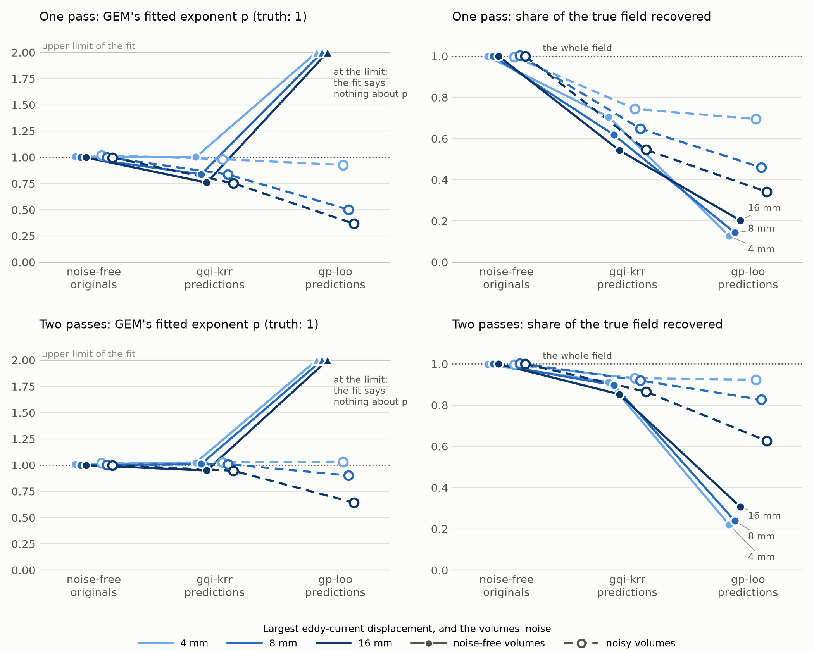
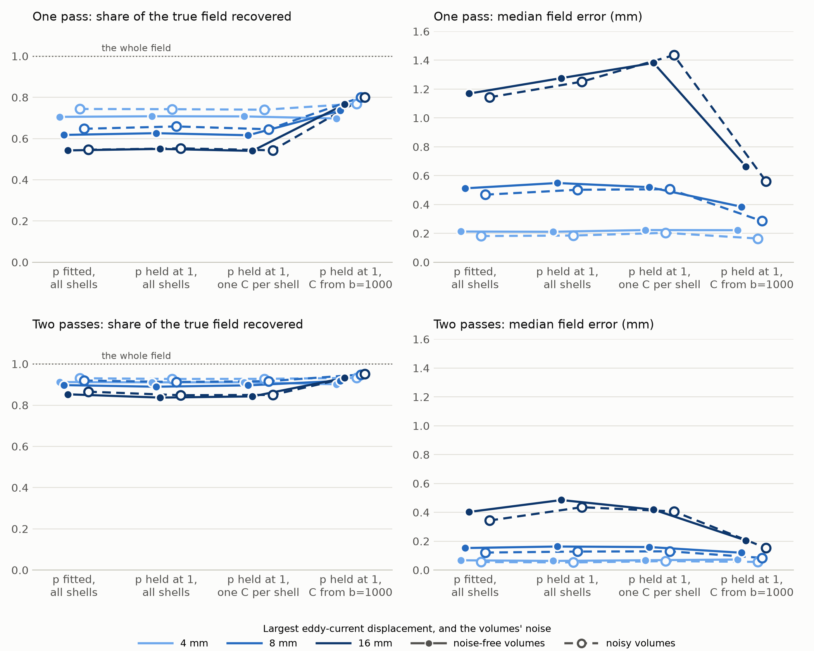

.. include:: ../links.rst

GEM's accuracy on the phantom
=============================
On the phantom (:doc:`phantoms`), the true field of every volume is known, so GEM's
estimates can be scored against it.

Data
----
The phantom is TRXScan's adult brain under the Sherbrooke protocol: 128 × 128 × 60
voxels of 2 mm, and 64 gradient directions at each of b=1000, 2000 and 3500 s/mm².
Its copies without head motion have eddy currents whose largest displacement in the
brain is 2, 4 and 8 voxels: 4, 8 and 16 mm.
TRXScan applies one strength to every volume, so each volume's field follows its
b-value, and the truth's exponent is 1.
The phantom's fields are zero at a point of its own
(`#744 <https://github.com/nipreps/nifreeze/issues/744>`__), which GEM is given as its
zero point.

The copies have no head motion, and the pass is given none, so GEM estimates the
fields alone.
Each copy is registered twice: noise-free, as simulated, and with the protocol's noise.
The noise is complex Gaussian, with a standard deviation of 3.0 in each channel, and
the magnitude is kept, as in :doc:`registration-floor`.
GEM is fitted to three targets:

Noise-free originals
    each volume as simulated without eddy currents, noise-free: what a perfect model
    would predict;
gqi-krr predictions, gp-loo predictions
    each volume's prediction by that model (:doc:`/methods/models`), from the copy.

Each fit runs in three cascaded passes (:ref:`gem-cascade`).
Three more fits to gqi-krr's predictions hold the exponent (:ref:`gem-b1000`).

What is measured
----------------
Each fit is scored with two numbers:

- the fitted exponent :math:`p`, against the truth's 1;
- the share of the true field that GEM recovers: the gain of the estimated slopes
  :math:`s` on the true ones :math:`t`, :math:`\sum s \cdot t / \sum t \cdot t` over the
  volumes. The share is 1 when GEM recovers the whole field, and 0 when it recovers
  none of it;
- the median, over the volumes, of each volume's field error: the mean, over the brain,
  of the distance between where the estimated and the true mappings move each voxel's
  center.

.. _gem-recovers:

What GEM recovers
-----------------

   GEM's fitted exponent (left) and the share of the true field it recovers (right),
   with each of the three targets, after one pass (top), two (middle) and three (bottom).
   Each line is one copy of the phantom, by the largest displacement of its eddy
   currents (4, 8 and 16 mm, light to dark blue).
   Solid lines and filled dots are the noise-free copies, and dashed lines and hollow
   dots the same copies with the protocol's noise.
   The dotted line is the truth.
   Triangles are fits whose exponent stopped at the upper limit of the fit, 2.

.. csv-table:: The values of the figure.
   :file: ../_static/gem/gem-accuracy.csv
   :header-rows: 1

On the phantom, GEM's accuracy is set by its targets:

- From the noise-free originals, GEM recovers the whole field, and :math:`p` is
  within 0.02 of the truth's, with or without noise.
  The median field error is at most 0.003 mm without noise, and 0.012 mm with it.
  The originals never move, so later passes change nothing.
- From predictions, one pass recovers less of the field, and less as the fields grow:
  with gqi-krr's predictions of the noise-free copies, from 0.71 of it at 4 mm to 0.54
  at 16 mm.
  Each prediction is made from the other volumes, whose fields resemble its volume's
  where their gradients do, so it carries part of its volume's distortion; registered
  to it, a volume is corrected for the rest.
- The larger a volume's field, the smaller the share that GEM recovers, so the
  estimated fields grow more slowly with the b-value than the true ones, and the
  fitted exponent falls below the truth's.
  With gqi-krr's predictions of the noise-free copy with 16 mm, for instance, one pass
  recovers 70% of the field at b=1000, 59% at b=2000 and 51% at b=3500, and :math:`p`
  is 0.76.
- Each later pass predicts each volume from the volumes that the pass before corrected,
  so its predictions carry part of what that pass left, not of the whole field.
  With gqi-krr, the first pass's predictions carry 26% to 46% of the field, the
  second's 23% to 32% of what the first left, and the third's 25% to 41% of what the
  second left.
  Carried at the second pass's rate, the third pass's share would be within 0.01 of
  the one measured.
- Two passes recover 0.85 to 0.93 of the field, and :math:`p` is within 0.05 of the
  truth's; three recover 0.96 to 0.98, and :math:`p` is within 0.02.
  The median field error falls by a factor of 2.9 to 3.9 from one pass to two, and of
  2.9 to 3.4 from two to three at 8 and 16 mm: at 16 mm, from 1.17 to 0.40 and 0.12 mm
  without noise, and from 1.14 to 0.34 and 0.10 mm with it.
  At 4 mm, the third pass halves it, to 0.03 mm.
- Without noise, gp-loo's predictions carry most of each volume's distortion: GEM
  recovers 13% to 20% of the field in one pass, 22% to 31% in two, and 29% to 37% in
  three.
  The exponent then stops at the upper limit of the fit, and says nothing about the
  field.
  With noise, two passes recover 0.63 to 0.92 of it, and three 0.84 to 0.97.

.. _gem-b1000:

Fitting C at b=1000
-------------------
In one pass, from predictions, GEM recovers less of the larger fields, so a fit to every
shell finds an exponent below the truth's.
Three more fits to gqi-krr's predictions hold the exponent at the truth's, 1, and differ
in what they fit:

One C for all the shells
    ``GEM(exponent=1)``;
One C for each shell
    ``GEM(edges=(1500, 2750), exponent=1)``;
C from b=1000
    one :math:`C`, fitted on the b=1000 shell only, which gives every volume its field
    (:ref:`gem-fit-range`): ``GEM(fit_range=(0, 1500), exponent=1)``.

   The share of the true field that GEM recovers from gqi-krr's predictions (left), and
   the median field error (right), for each way of fitting it, after one pass (top), two
   (middle) and three (bottom).
   Lines and dots are as in the figure above.

.. csv-table:: The values of the figure.
   :file: ../_static/gem/gem-fits.csv
   :header-rows: 1

.. csv-table:: The share of the true field that each shell recovers, with one C for each
   shell, gqi-krr's predictions.
   :file: ../_static/gem/gem-shells.csv
   :header-rows: 1

- Holding the exponent does not help by itself.
  With one :math:`C` for all the shells, or one for each, the share stays within 0.02 of
  the default fit's in every pass.
  The median field error is never more than 0.005 mm smaller, and is larger at 16 mm:
  by up to 0.29 mm in one pass, 0.09 mm in two and 0.02 mm in three.
- Fitted at b=1000, :math:`C` gives every shell 0.70 to 0.80 of its field in one pass.
  At 16 mm, the median field error is about half the default fit's: 0.66 against
  1.17 mm without noise, and 0.56 against 1.14 mm with it.
  At 4 mm, the four fits are alike.
- After two passes, :math:`C` from b=1000 recovers 0.90 to 0.95 of the field, and its
  error at 16 mm is still about half the default fit's: 0.21 against 0.40 mm without
  noise, and 0.15 against 0.34 mm with it.
- After three passes, it recovers 0.96 to 0.99 of the field.
  At 16 mm, its error is 0.07 against the default fit's 0.12 mm without noise, and
  0.06 against 0.10 mm with it; at 4 and 8 mm, it is within 0.011 mm of the default
  fit's, either way.
- Fitted on its own, in one pass, each shell recovers about the same share at 4 mm.
  At 8 and 16 mm, the b=1000 shell recovers the most, with or without noise: at 16 mm,
  0.77 to 0.80 of its field, against 0.49 to 0.54 for the other shells.
  These runs do not say why.
  The gap closes over the passes: at 16 mm, 0.90 to 0.92 against 0.83 to 0.86 in two,
  and in three every shell recovers 0.95 to 0.98 of its field, at every size.
- Here the exponent is held at the truth's.
  On real data it must be given, and a wrong exponent goes straight to the high shells:
  held at 1/2 when the truth is 1, the b=3500 fields would come out at 0.53 of their
  size.

Whether real eddy currents follow GEM is the question of
`#752 <https://github.com/nipreps/nifreeze/issues/752>`__.

Reproducing the figures
-----------------------
The experiment runs GEM on the six copies (three sizes, without and with noise), with
each of its six fits in three passes, in about 3 hours on 6 CPUs::

    taskset -c 0-5 python tools/registration/eddy_model_accuracy.py \
        --dataset <phantoms> --out <results>
    python tools/registration/eddy_model_accuracy_figures.py \
        --results <results> --out docs/_static/gem

The first command writes each run's estimates and scores, and
``<results>/accuracy.{tsv,json}``; the second draws the figures and their tables from
them.
