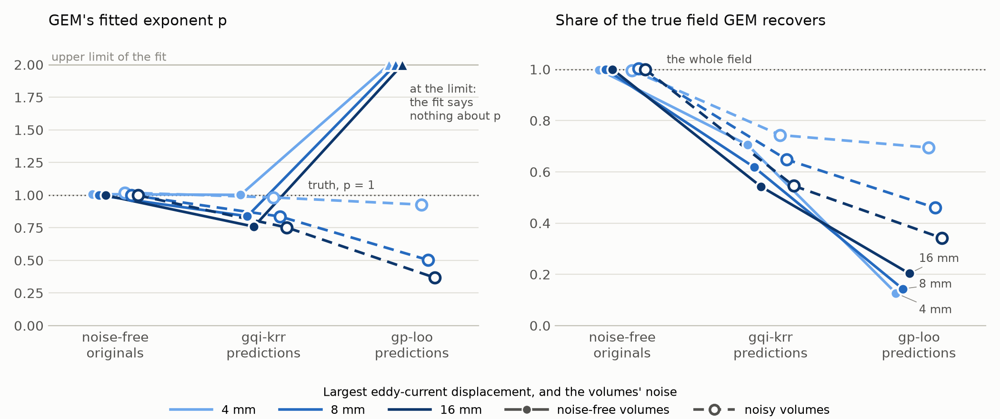

.. include:: links.rst

The global eddy model (GEM)
===========================
*NiFreeze* can estimate the eddy currents of a DWI by registering each volume, on its
own, to a prediction of it (``--eddy``).
The global eddy model (GEM) estimates them for all the volumes at once instead, with a
model of how the field of the eddy currents follows the diffusion gradient
(:class:`~nifreeze.registration.eddy_field.EddyFieldFit`,
`#746 <https://github.com/nipreps/nifreeze/pull/746>`__).

The model
---------
A field of eddy currents that is linear in position moves points only along the
phase-encoding direction :math:`u`.
Its mapping is :math:`E = I - u s^T`: a point :math:`x` moves by :math:`-(s^T x)\, u`,
where the three *slopes* :math:`s` set how the displacement grows along each axis of
the scanner.
The field comes from the diffusion gradient, so its slopes follow the gradient.
In volume :math:`v`, with the unit b-vector :math:`g_v` and the b-value :math:`b_v`,

.. math::

    s_v = \left(\frac{b_v}{b_\text{ref}}\right)^p C g_v,

where the 3 × 3 matrix :math:`C` and the exponent :math:`p` are the same for every
volume (:class:`~nifreeze.registration.eddy_field.EddyField`), and the reference
b-value :math:`b_\text{ref}` is the geometric mean of the b-values.
The exponent is 1/2 when the field follows the gradient's strength at a fixed timing,
and 1 when it follows the b-value, as in the phantoms that TRXScan makes
(:doc:`phantoms`).
GEM estimates :math:`p` between 0 and 2.

The fields are zero at one point, by default the center of the field of view, the
middle of its physical extent
(:func:`~nifreeze.registration.eddy_field.field_of_view_centre`).
A field that is zero at the point :math:`z` also translates the volume along
:math:`u`, by :math:`s^T z`.
That translation is part of the head motion, by the convention of
:func:`~nifreeze.registration.utils.split_phase_encoding`, which splits a volume's
mapping into head motion and a field without translation.
GEM derives each volume's translation along :math:`u` from its slopes and the zero
point, and each volume keeps the rest of the head motion it is given.

GEM comes in two forms:

One model for all the volumes
    One :math:`C` and one :math:`p` (the default): 10 parameters, or 9 with the
    exponent held.
One model for each shell
    One :math:`C` for each segment of b-values, between the edges that the caller gives
    (:class:`~nifreeze.registration.eddy_field.SegmentedEddyField`).
    The exponent is held, at 1/2 by default, and each segment's reference b-value is
    the geometric mean of its b-values.
    On shelled data, every volume of a segment has the same b-value, so the exponent
    makes no difference.

A stretch that every volume shares has no parameter of its own to go into, as long as
the b-vectors average out.
Fitted on the images, where the volumes weigh a little differently, a small part of it
still reaches the fields.

How GEM is estimated
--------------------
Estimating GEM is one registration of all the volumes at once, with one set of
parameters, in which each volume moves by its own field.
The cost is the sum, over the volumes, of ITK's similarity metric between each
volume and its target, run in the stages of the ``itk`` section of
:data:`~nifreeze.registration.base.AFFINE`.
ITK's metric evaluates each volume's similarity and its derivative, and scipy's
L-BFGS-B estimates the model's parameters.
The images are prepared as for ITK's registration of each volume on its own: clipped to
the volume's intensity window, winsorized and histogram-matched as the settings ask.

Running GEM
-----------
GEM runs in the estimator's eddy-current pass, given as its registration:

.. code-block:: python

    from nifreeze.estimator import Estimator
    from nifreeze.registration.eddy_field import EddyFieldFit

    Estimator("gqi-krr", estimates="eddy", registration=EddyFieldFit()).run(dwi)

The pass predicts every volume first, all from the same data, and adds each to the fit
with its head motion; it then estimates the model and stores each volume's head motion
and field in the dataset.
The fit takes the dataset's phase-encoding direction, unless it is given its own
(``phase_encoding``).
One model for each shell takes the edges between the shells, for instance
``EddyFieldFit(edges=(1500, 2750))`` for shells at b=1000, 2000 and 3500 s/mm².
``zero_point`` sets where the fields are zero, in world (RAS+) coordinates, in mm.
The command line's ``--eddy`` registers each volume on its own.

The antecedent: FSL eddy's second-level model
---------------------------------------------
FSL's ``eddy`` :footcite:p:`andersson_integrated_2016` estimates a field for each
volume.
With ``--slm linear`` (off by default), each of the field's coefficients except its
offset is pooled over the diffusion-weighted volumes of every shell, and replaced by
its least-squares fit on :math:`(b_v / 1000)\, g_v`, without an intercept.
For the slopes, that is GEM with one model for all the volumes and :math:`p = 1`.
``eddy`` applies it in each iteration, after the step that updates each volume's
estimates.
FSL recommends it for data with few directions, or whose directions do not cover the
whole sphere.
GEM differs from it in four ways:

1. GEM is fitted on the images, in one registration of all the volumes, while ``eddy``
   fits its model to the volumes' own estimates, each counting the same.
2. GEM estimates the exponent, or holds it at a value the caller gives; ``eddy``
   holds it at 1.
3. GEM's zero point is given.
   By default, ``eddy`` regresses the sum of each volume's field offset and translation
   along phase encoding on the gradients, across the volumes: the fit becomes the
   offset, and the rest the translation.
   In effect, its fields' zero point is estimated.
4. GEM can fit one model for each shell.

Accuracy on the phantom
-----------------------
On the phantom (:doc:`phantoms`), the true field of every volume is known, so GEM's
estimates can be scored against it.

Data
~~~~
The phantom is TRXScan's adult brain under the Sherbrooke protocol: 128 × 128 × 60
voxels of 2 mm, and 64 gradient directions at each of b=1000, 2000 and 3500 s/mm².
Its copies without head motion have eddy currents whose largest displacement in the
brain is 2, 4 and 8 voxels: 4, 8 and 16 mm.
TRXScan applies one strength to every volume, so each volume's field follows its
b-value, and the truth's exponent is 1.
The phantom's fields are zero at a point of its own
(`#744 <https://github.com/nipreps/nifreeze/issues/744>`__), which GEM is given as its
zero point.

The copies have no head motion, and the pass is given none, so GEM estimates the
fields alone.
Each copy is registered twice: noise-free, as simulated, and with the protocol's noise.
The noise is complex Gaussian, with a standard deviation of 3.0 in each channel, and
the magnitude is kept, as in :doc:`registration`.
GEM is fitted to three targets:

Noise-free originals
    each volume as simulated without eddy currents, noise-free: what a perfect model
    would predict;
gqi-krr predictions, gp-loo predictions
    each volume's prediction by that model (:doc:`models`), from the copy.

What is measured
~~~~~~~~~~~~~~~~
Each fit is scored with two numbers:

- the fitted exponent :math:`p`, against the truth's 1;
- the share of the true field that GEM recovers: the gain of the estimated slopes
  :math:`s` on the true ones :math:`t`, :math:`\sum s \cdot t / \sum t \cdot t` over the
  volumes. The share is 1 when GEM recovers the whole field, and 0 when it recovers
  none of it.

What GEM recovers
~~~~~~~~~~~~~~~~~

   GEM's fitted exponent (left) and the share of the true field it recovers (right),
   with each of the three targets.
   Each line is one copy of the phantom, by the largest displacement of its eddy
   currents (4, 8 and 16 mm, light to dark blue).
   Solid lines and filled dots are the noise-free copies, and dashed lines and hollow
   dots the same copies with the protocol's noise.
   The dotted line is the truth.
   Triangles are fits whose exponent stopped at the upper limit of the fit, 2.

.. csv-table:: The values of the figure.
   :file: _static/gem/gem-accuracy.csv
   :header-rows: 1

On the phantom, GEM's accuracy is set by its targets:

- From the noise-free originals, GEM recovers the whole field, and :math:`p` is
  within 0.02 of the truth's, with or without noise.
  The median field error, over the volumes, is 0.002 mm without noise and 0.010 mm
  with it: the mean, over the brain, of the distance between where the estimated
  and the true mappings move each voxel's center.
- From predictions, it recovers less of the field, and less as the fields grow.
  Each prediction is made from the other volumes, whose fields resemble its volume's
  where their gradients do, so it carries part of its volume's distortion; registered
  to it, a volume is corrected for the rest.
- The larger a volume's field, the smaller the share that GEM recovers, so the
  estimated fields grow more slowly with the b-value than the true ones, and the
  fitted exponent falls below the truth's.
  With gqi-krr's predictions of the noise-free copy with 16 mm, for instance, GEM
  recovers 70% of the field at b=1000, 59% at b=2000 and 51% at b=3500, and :math:`p`
  is 0.76.
- Without noise, GEM recovers only 13% to 20% of the field from gp-loo's predictions,
  which therefore carry most of each volume's distortion.
  The exponent then stops at the upper limit of the fit, and says nothing about the
  field.

Whether real eddy currents follow GEM is the question of
`#752 <https://github.com/nipreps/nifreeze/issues/752>`__.

Reproducing the figure
~~~~~~~~~~~~~~~~~~~~~~
The experiment runs GEM on the six copies (three sizes, without and with noise) with
each target, in about 25 minutes on 6 CPUs::

    taskset -c 0-5 python tools/registration/eddy_model_accuracy.py \
        --dataset <phantoms> --out <results>
    python tools/registration/eddy_model_accuracy_figures.py \
        --results <results> --out docs/_static/gem

The first command writes each run's estimates and scores, and
``<results>/accuracy.{tsv,json}``; the second draws the figure and its table from them.

.. footbibliography::
