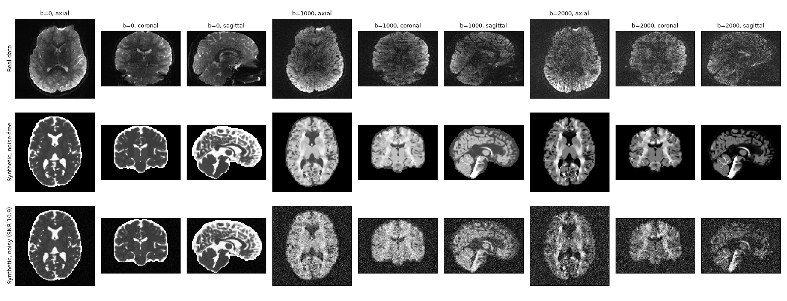
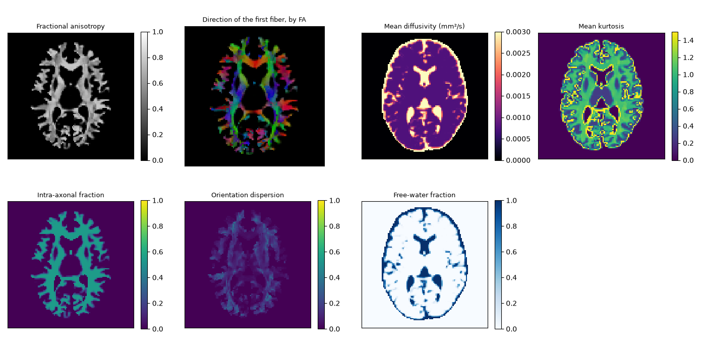
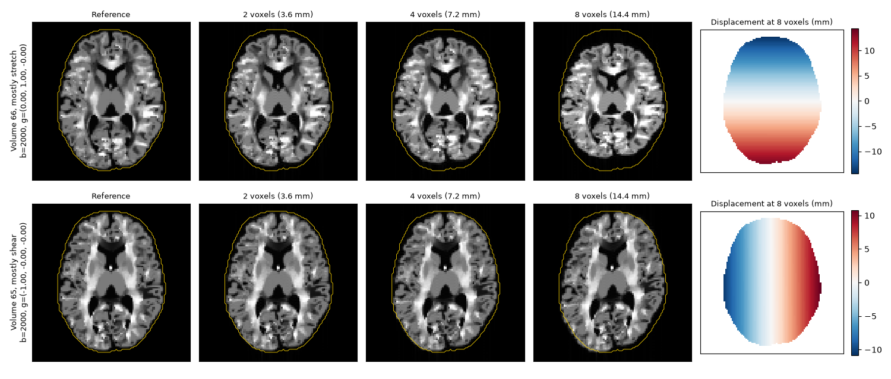
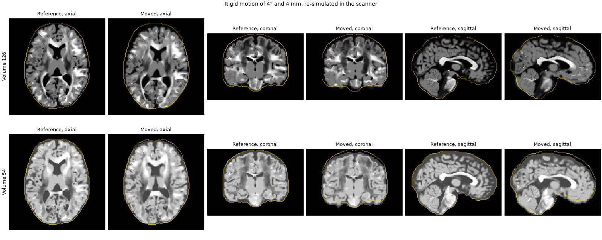

.. include:: links.rst

Synthetic reference data
========================
The sensitivity benchmarks compare model predictions on an aligned dataset with
predictions on copies of it whose volumes moved or were distorted by known
amounts.
Real data cannot serve as the aligned reference: they carry motion and
eddy-current distortions of their own, as large as the smallest perturbations
the benchmarks add.
*NiFreeze* therefore simulates its reference data with
`TRXScan <https://github.com/PennLINC/TRXScan>`__ (a port of MITK Fiberfox) from
one phantom anatomy, under the acquisition protocols of real studies, and
simulates every perturbation with its ground truth
(`#548 <https://github.com/nipreps/nifreeze/issues/548>`__).

Acquisition protocols
---------------------
The protocols are chosen to span the axes along which models differ most, while
standing for data that *NiFreeze* users actually process:

- the number of shells and the largest b-value (one to four shells, b=1000 to 3500);
- the number of directions per shell and the coverage of the sphere (32 to 150
  directions; half or whole sphere, which decides whether eddy-current
  distortions cancel over the directions);
- the voxel size and the signal-to-noise ratio it implies (1.25 to 2 mm);
- prevalence: the protocols behind large public datasets.

.. list-table::
   :header-rows: 1

   * - Protocol
     - Shells (directions)
     - b=0
     - Voxel (mm)
     - Scanner
     - Stands for
   * - HCP-YA
     - 1000, 2000, 3000 (90 each)
     - 18
     - 1.25
     - Siemens Skyra Connectom, 3 T
     - Dense, balanced multi-shell research data
   * - Healthy Brain Network
     - 1000, 2000 (64 each)
     - 1
     - 1.8
     - Siemens Prisma, 3 T
     - Large pediatric two-shell cohorts
   * - ABCD
     - 500, 1000, 2000, 3000 (6, 15, 15, 60)
     - 7
     - 1.7
     - Siemens Prisma, 3 T
     - Unbalanced shells with sparse inner shells
   * - Sherbrooke
     - 1000, 2000, 3500 (64 each)
     - 1
     - 2
     - Siemens, 1.5 T
     - The highest b-value; DIPY's multi-shell example
   * - Stanford HARDI
     - 2000 (150)
     - 10
     - 2
     - GE MR750, 3 T
     - High angular resolution on one shell
   * - AOMIC-PIOP2
     - 1000 (32, half sphere)
     - 1
     - 2
     - Philips, 3 T
     - The minimal clinical acquisition

``tools/phantoms/protocols.toml`` records, for each protocol, its gradient table
(``tools/phantoms/protocols/<name>.b``: one ``x y z b`` row per volume, unit
vectors in world RAS coordinates as prescribed), the source of the table with its
checksum, license and citation, the acquisition parameters the simulation needs,
and the signal-to-noise ratio of the b=0 images.
``tools/phantoms/fetch_protocols.py`` rebuilds the tables from their sources,
and its ``--check`` option compares them with the stored ones.
``tools/phantoms/measure_snr.py`` measures the signal-to-noise ratio on the
real data of each protocol, where they are openly available: from 8.9
(Sherbrooke, at 1.5 T) to 19.4 (AOMIC-PIOP2).
The values of HCP-YA (9.0) and ABCD (13.4), whose data are not openly
available, are extrapolated from published or measured ones, as the catalog
records.

Sources come in different frames, all converted to world RAS coordinates.
The b-vectors of HBN and AOMIC are converted with the header of the image they
came with; those of ABCD, Sherbrooke and Stanford are taken in the voxel frame of
an image aligned with the world axes (LAS for ABCD, as ``dcm2niix`` writes the
axial images of the same Siemens sites).
Diffusion contrast does not depend on the sign of a b-vector, so these
assumptions only affect the sign of simulated eddy-current distortions.
Three tables share one set of 64 directions, up to axis flips: those of HBN,
Sherbrooke and the single-shell dataset ``ds000114``, which is why the clinical
protocol is AOMIC-PIOP2 instead of the latter.

Generating the reference datasets
---------------------------------
``tools/phantoms/phantom.py`` is the only code that imports TRXScan, pinned to one
commit of its development branch (the motion fixes it needs are not released).
It is a script with inline dependencies, which ``uv`` builds into an environment
of its own::

    uv run tools/phantoms/phantom.py reference --protocol sherbrooke --out <dataset>

simulates TRXScan's adult phantom (subject sub-60501, 400,000 streamlines) under
one protocol of the catalog: its gradient table, voxel size, matrix,
phase-encoding axis and echo time (90 ms when the protocol does not document it).
The acquisition is clean: no motion, eddy currents, susceptibility distortion or
noise, and no T2 weighting along the readout, which would blur the images along
phase encoding; the T2 contrast between tissues comes from their signal at the
echo time instead.
The protocol's field of view is kept, so a short slab crops the phantom.
Under ``<dataset>/sub-60501/dwi`` it writes:

- ``*_rec-clean_dwi.nii.gz``: the noise-free magnitudes (``float32``);
- ``*_rec-noisy_dwi.nii.gz``: one noisy realization, at the protocol's
  signal-to-noise ratio, with complex Gaussian noise of standard deviation
  ``sigma = mean white-matter b=0 / SNR`` (stored as ``int16``);
- ``*_desc-brain_mask.nii.gz``, ``*_dwi.b`` (the gradients) and ``*_dwi.json``
  (the acquisition, the noise and the provenance);
- ``*_desc-<map>_truth.nii.gz``: TRXScan's ground truth, the fiber peaks and
  the scalar maps its compartments imply (FA, MD, kurtosis, NODDI and others).

The noise of each volume is drawn from a generator keyed on a seed and the
volume's index (:func:`nifreeze.testing.phantoms.add_noise`), so the analysis can
add the same noise to any stored noise-free volume, in the reference or in a
perturbed copy of it.
``uv run tools/phantoms/phantom.py verify`` checks, at a coarse resolution and
for every protocol, that repeated runs are identical and that a subset of the
gradient table reproduces the same volumes of the full run, which the perturbed
copies rely on.

Perturbed copies
----------------
::

    uv run tools/phantoms/phantom.py cells --protocol sherbrooke --out <dataset>

simulates the perturbations of the reference, each with its exact ground truth.
Only diffusion-weighted volumes are perturbed.

Rigid motion
    For each seed and magnitude m (0.5, 1, 2 and 4 by default), every volume
    gets a rotation of m degrees about a random axis through the brain's
    centroid and a translation of m mm in a random direction, drawn by
    :func:`~nifreeze.testing.perturbations.perturbation_plan`.
    Each moved volume is simulated again from the phantom moved in the scanner,
    on the reference's grid, so the anatomy turns relative to the gradients as in
    a real scan.
Eddy currents
    For each magnitude e (2, 4 and 8 voxels by default), every volume is
    simulated with TRXScan's linear eddy-current model, without decay over the
    readout, at the strength that displaces some voxel of the brain by e voxels
    along phase encoding.
    TRXScan applies one strength to every volume, so each volume is distorted in
    proportion to its b-value and its most distorted voxels lie at the edges of
    the brain; at the weakest magnitude, the typical volume moves some voxel by
    about one voxel.
    The displacement of each volume is known in closed form: a
    :class:`~nifreeze.analysis.sensitivity.Distortion` along phase encoding,
    with one term per voxel axis (TRXScan applies the b-vector's world
    components to the grid axes as given).
Both
    Every moved volume is also simulated with each eddy-current magnitude.

Only the changed volumes are written, noise-free, under
``<dataset>/derivatives/perturbations/sub-60501/dwi``, one file per set:
``desc-e<e>`` (every diffusion-weighted volume, with eddy currents of e voxels),
``desc-m<m>s<seed>`` (the moved volumes) and ``desc-m<m>s<seed>e<e>`` (the moved
volumes with eddy currents), where ``0.5`` is written ``0p5``.
The moved volumes come in the order of the plan, so a copy with K moved volumes
takes the first K of them; the copy that moves one volume alone takes just that
one.
Each file has a sidecar with the index of each of its volumes in the reference
(``SourceVolumes``), the motion matrices in world coordinates (``Motion``,
mapping head positions before the motion to positions after it), and the
eddy-current strength, coefficients and the acquisition time of each
phase-encoding line (``Eddy``).
A copy is assembled from the reference: the eddy-current volumes of magnitude e
replace their counterparts, then the first K moved volumes replace theirs.

``verify`` also checks that the closed-form displacement reproduces TRXScan's
eddy-current images (within 10⁻⁴), and that a moved volume's center of mass moves
as its matrix says (within a fifth of a voxel).
A moved volume takes about 35 s at 2 mm (about 50 s at 1.25 mm) on a laptop:
the moved phantom is gridded once, then simulated without and with each of the
three eddy-current magnitudes. The default grid of one protocol thus takes from
about 1.5 hours (AOMIC-PIOP2) to 14 hours (HCP-YA) in one process.
Most of that time is serial, and more threads barely shorten it, so
``cells --jobs N`` simulates the moved volumes in N processes, which share the
threads of ``RAYON_NUM_THREADS`` and write the same files.
On an 18-core workstation, 16 processes simulate ten times as many moved volumes
per hour as one; each process needs about 1.8 GB at 2 mm and 3.7 GB at 1.25 mm.

TRXScan's signal is a sum of Gaussian compartments, as the tensor and kurtosis
models assume, so these models may fit the synthetic data better than real ones.

Analyzing a phantom
-------------------
:func:`~nifreeze.analysis.phantoms.load_phantom` reads one protocol of a phantom
dataset as :func:`~nifreeze.analysis.sensitivity.sensitivity` takes it::

    from nifreeze.analysis.phantoms import load_phantom
    from nifreeze.analysis.sensitivity import sensitivity

    reference, cells = load_phantom("<dataset>", "sherbrooke", noise=0, counts=[6, 24])
    rows = sensitivity("gqi", reference, cells)

The reference keeps its diffusion-weighted volumes, numbered from 0 (its b=0
volumes are averaged into ``bzero``), and every volume gets the noise of the
given seed on load.
Each copy is loaded only when it is analyzed: the reference, with the copy's
changed volumes spliced in.
``counts`` turns each set of moved volumes into the copies that move its first K,
and ``alone`` into copies that move one of its volumes alone, with the motion the
set gives it, to rank the volumes by their influence.

The eddy currents of a copy come with their closed form
(:meth:`~nifreeze.analysis.sensitivity.Distortion.from_sidecar`), including the
time at which each phase-encoding line is acquired. The analysis can thus form a
distorted volume as TRXScan's readout does, within 10⁻⁵ of TRXScan's images.

The dataset of continuous integration
-------------------------------------
::

    uv run tools/phantoms/phantom.py fixture --out <dataset>

simulates a dataset small enough for every pull request (about 21 MB, under two
minutes on a laptop): the Sherbrooke protocol at 4 mm with 50,000 streamlines,
keeping its b=0 volume and 8 directions of each shell, spread over the sphere.
It writes the reference and three perturbed copies, with the layout above:
rigid motion of every diffusion-weighted volume at 1° and 1 mm (whose first
quarter is a copy too), eddy currents of 2 voxels, and both.
The volumes keep their order in the protocol; the sidecars list them
(``ProtocolVolumes``), and the gradient file holds only their rows.

In GitHub Actions, the composite action ``.github/actions/phantom-fixtures``
restores this dataset from the cache, or simulates it when the generator, its
environment, the protocol or the NiFreeze code it calls have changed, and points
the ``NIFREEZE_PHANTOMS`` environment variable to it.
The generator's environment is locked in ``tools/phantoms/phantom.py.lock``
(``uv lock --script tools/phantoms/phantom.py``), so that a dataset simulated
again comes from the same versions of every package.

The end-to-end tests (``test/test_e2e_motion.py``, opt-in with ``pytest -m e2e``)
read the Sherbrooke protocol at its native resolution instead. The workflow
``.github/workflows/e2e.yml`` fetches the files they read from the GIN dataset
``nipreps-data/nifreeze-trxscan``, at the commit their gates were set on, and
fails when a test is skipped.

Example: the Healthy Brain Network protocol
-------------------------------------------
The figures below show the HBN protocol (1.8 mm, two shells of 64 directions),
drawn by ``tools/phantoms/figures.py`` from a dataset generated with
``phantom.py`` (the reference, and copies with 4° and 4 mm of motion and with
eddy currents of 2, 4 and 8 voxels), next to a real HBN subject acquired with the
same gradient table::

    python tools/phantoms/figures.py --dataset <dataset> --protocol hbn \
        --real <real_dwi.nii.gz> --out docs/_static/phantoms

   A real HBN subject (top) and the synthetic dataset, noise-free and at the
   protocol's signal-to-noise ratio, at b=0 and at the first volume of each shell.
   The synthetic tissues are piecewise constant, without the texture of real
   brains, and the head around the brain is not simulated.

   The ground truth written with the reference: the scalar maps the simulated
   compartments imply, and the orientation of the first fiber.

   Eddy currents of 2, 4 and 8 voxels on the volume most stretched along phase
   encoding (gradient along it, top) and the most sheared (gradient along the
   readout, bottom), with the outline of the undistorted brain. On the right, the
   displacement of each at 8 voxels, from the coefficients stored in its sidecar.

   Two moved volumes against the reference, with the outline of the reference
   brain. Each moved volume is simulated anew from the moved phantom, so its
   contrast also changes as the fibers turn relative to the gradient.

