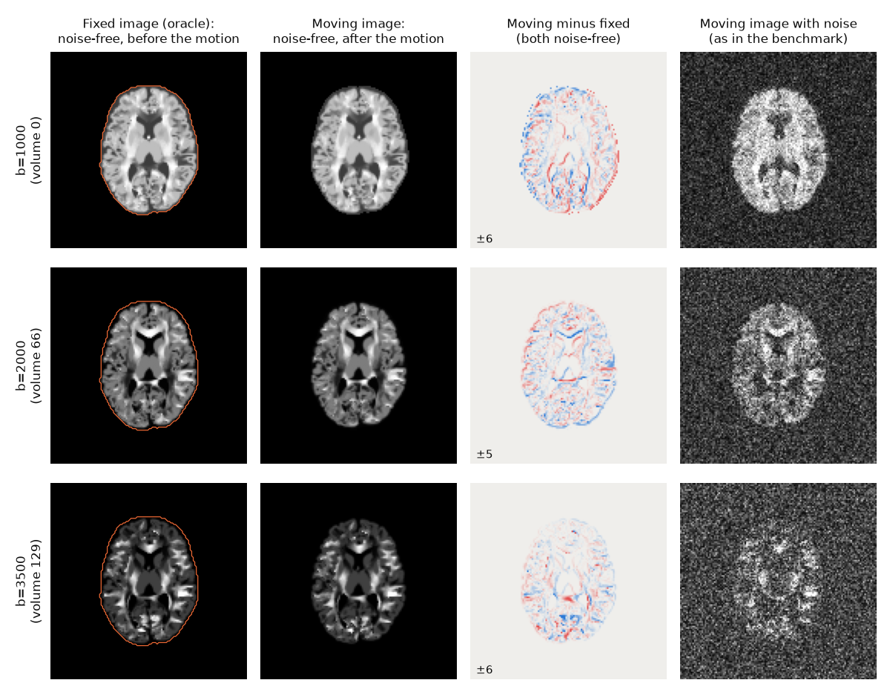
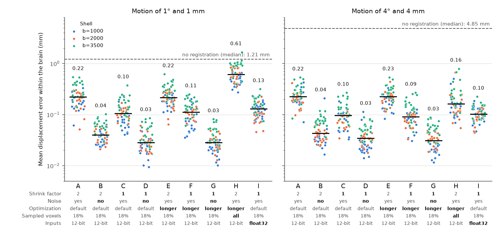
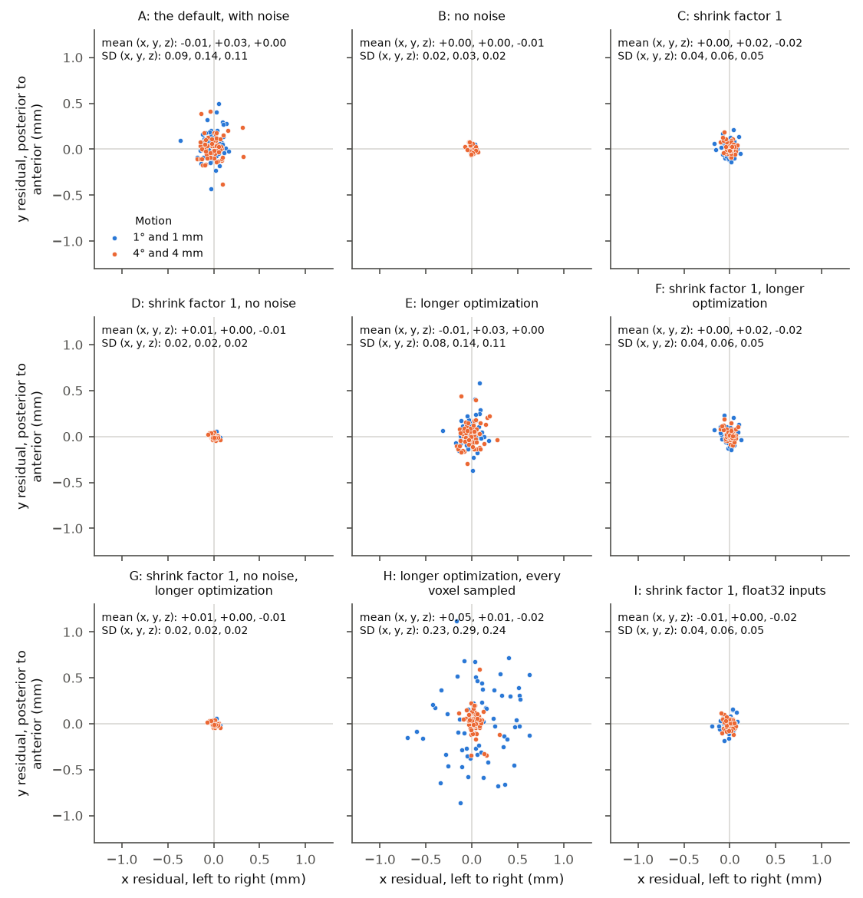

.. include:: links.rst

Registration accuracy
=====================
*NiFreeze* estimates head motion by registering each volume to a prediction of it.
How accurate that registration can be is measured on the synthetic phantom
(:doc:`phantoms`), where the true motion of every volume is known exactly.

What limits registration to a perfect target
--------------------------------------------
This section reports an experiment on the error that remains when registration
gets the best possible fixed image
(`#609 <https://github.com/nipreps/nifreeze/issues/609>`__).

The question
~~~~~~~~~~~~
The registration benchmark (``tools/registration/bench.py``,
`#584 <https://github.com/nipreps/nifreeze/issues/584>`__) takes the Sherbrooke
phantom at its original resolution of 2 mm, moves its volumes by known amounts, and
registers each moved volume to several fixed images.
One of them is the *oracle*: the noise-free simulation of the same gradient
direction, with the head at its reference position, before the motion.
The oracle is what a perfect model would predict for that volume, so the error of
registering to it is the error of registration alone.
With the estimator's default ANTs settings, that error was about 0.2 mm at every
motion size, from 0.5° and 0.5 mm to 4° and 4 mm.
Over the 192 volumes, the median of the mean displacement error within the brain
(defined below) was 0.20, 0.22, 0.22 and 0.23 mm at the four sizes (the tables
``derivatives/registration/sherbrooke/desc-m*_oracle.tsv`` of the phantom dataset).
Variant A below repeats that setting on a third of the volumes, and finds 0.22 mm at
both sizes it tests.

An error that does not grow with the motion is a floor: something other than the
size of the motion sets it.
This experiment tests five candidates:

1. **Resolution.** The last stage of the default settings runs at shrink factor 2:
   ANTs computes the similarity of the two images on a grid with half as many
   points as the image along each axis, one eighth in total.
   Registration never works on the images at full resolution.
2. **Noise.** The moving volume carries the noise of the protocol, while the oracle
   is noise-free.
3. **Optimization.** The last stage runs at most 10 iterations, and stops earlier
   if the similarity stops improving. It may stop before the best transform.
4. **Sampling.** The similarity is computed on a random 18% of the grid's points,
   not on all of them.
5. **Coding of the inputs.** Before writing the two images for ANTs, *NiFreeze*
   clips both to an intensity window computed from the moving image: the 1st and
   99.98th percentiles, within the brain mask, of a median-filtered copy of it.
   It then stores the clipped intensities as 12-bit integers (4,096 levels across
   the window), which rounds them.

Data
~~~~
The phantom is TRXScan's adult brain under the Sherbrooke protocol
(:doc:`phantoms`): 128 × 128 × 60 voxels of 2 mm, one b=0 volume, and 64 gradient
directions at each of b=1000, 2000 and 3500 s/mm².
In its moved copies, every diffusion-weighted volume moves: the head is rotated by
exactly *m* degrees about an axis drawn at random through the center of the brain,
shifted by exactly *m* mm in a direction drawn at random, and the volume is then
simulated again from the moved phantom.
This experiment uses the copies with *m* = 1 and *m* = 4, and every third volume:
64 of the 192, of which 22 are at b=1000, 21 at b=2000 and 21 at b=3500.

The moving volumes are registered with noise, as in the benchmark, and without.
The noise is complex Gaussian with a standard deviation of 3.0 in each channel,
and the magnitude is kept, so it follows a Rice distribution.
It is added on loading, with the benchmark's seed (20261029), so the noisy volumes
are the benchmark's.
That standard deviation comes from the protocol's signal-to-noise ratio of 8.9 at
b=0: the mean b=0 signal in white matter divided by the standard deviation of the
noise (:doc:`phantoms`).
Diffusion weighting lowers the signal, so the ratio is lower at higher b-values.
The brain mask (171,170 voxels) limits where ANTs computes the similarity, on the
fixed image, and where the error is measured.

   One volume of each shell at *m* = 1, on an axial slice through the center of the
   brain, with the brain mask outlined on the fixed image.
   The fixed image (the oracle) and the moving image share each row's intensity
   window. The third column subtracts the fixed image from the noise-free moving
   image, in the simulation's intensity units: blue is negative, red positive, and
   the colors saturate at the value printed in the corner. Edges show where the
   head moved. The last column is the moving image that the benchmark registers.

How the error is measured
~~~~~~~~~~~~~~~~~~~~~~~~~
Registration returns a rigid transform, the *estimate*; the phantom's sidecars give
the *true* transform.
For each voxel inside the brain mask, the displacement error is the distance
between the point where the estimate maps the voxel's center and the point where
the true transform maps it.
The error of one registration is the mean of that distance over the brain
(:func:`~nifreeze.registration.utils.displacements_within_mask`).
Each variant below reports the median and the 95th percentile (p95) of this error
over the 64 volumes.
Not registering at all (returning the identity) has the true motion as its error:
a median of 1.21 mm at *m* = 1, and 4.85 mm at *m* = 4.

The ANTs settings
~~~~~~~~~~~~~~~~~
*NiFreeze* builds its ANTs command from
``src/nifreeze/registration/config/b0-to-b0_level0.json``.
This is the command of the benchmark, with the file names replaced by placeholders:
``fixed.nii`` is the oracle, ``moving.nii`` the moved volume and ``mask.nii`` the
brain mask.

.. literalinclude:: _static/registration/floor-command.txt
   :language: bash

The command runs two stages, one after the other, each estimating a rigid
transform; the second starts from the result of the first.
The descriptions follow ``antsRegistration --help`` (ANTs 2.4.4).

.. list-table::
   :header-rows: 1
   :widths: 20 12 12 56

   * - Option
     - Stage 1
     - Stage 2 (last)
     - What it sets
   * - ``--transform Rigid[ step ]``
     - 12.0
     - 1.96
     - A rigid transform, and the gradient step of its optimizer.
   * - ``--metric GC[ fixed, moving, 1, r, Random, p ]``
     - *p* = 0.4
     - *p* = 0.18
     - The similarity: global correlation (GC), the correlation of the two images'
       intensities over a set of points. GC does not use the radius *r*.
       ``Random`` draws a fraction *p* of the grid's points, on "a random lattice of
       points slightly perturbed to minimize aliasing artifacts"; the alternative,
       ``None``, is "a dense sampling of one sample per voxel".
   * - ``--convergence [ n, threshold, window ]``
     - [ 20, 1e-06, 4 ]
     - [ 10, 1e-07, 2 ]
     - At most *n* iterations. The stage stops earlier when a line fitted to the
       similarity over the last *window* iterations has a slope below
       *threshold*.
   * - ``--smoothing-sigmas``
     - 2.71 voxels
     - 0 (none)
     - Gaussian smoothing of the images before the stage.
   * - ``--shrink-factors``
     - 3
     - 2
     - The shrink factor of "the virtual domain (typically the fixed image)": the
       grid on which the similarity is computed.
   * - ``--masks [ fixed, moving ]``
     - brain mask, none
     - brain mask, none
     - The points where the similarity is computed must fall inside the fixed
       image's mask.

Both stages match the two images' histograms and clip their intensities to the
quantiles 0.063 and 0.991 (``--use-histogram-matching 1``,
``--winsorize-image-intensities``).
The random sampling uses the same seed in every registration
(``ANTS_RANDOM_SEED=12345``).

The variants change only the second stage, or the images given to ANTs:

.. csv-table:: The nine variants, and the second-stage options in which each differs
   from A, as ANTs receives them. Noise and the coding of the inputs are not ANTs
   options.
   :file: _static/registration/floor-variants.csv
   :header-rows: 1
   :widths: auto

- **A** is the benchmark's setting.
- **B**, **C** and **D** cross the shrink factor (2 or 1) with the noise (with or
  without).
- **E**, **F** and **G** run a longer optimization: a gradient step of 0.25 instead
  of 1.96, up to 100 iterations instead of 10, and a stricter convergence (a slope
  below 1e-8 over 10 iterations). The smaller step makes smaller updates, so the
  optimizer can settle closer to the best transform instead of stepping over it;
  the extra iterations let it travel as far as the default does. ANTs does not
  document the unit of the step. If the default optimization stopped before the
  best transform, these variants should be more accurate than A, C and D.
- **H** computes the similarity at every voxel of the grid (``None, 1``) instead of
  a random 18%. It also has the longer optimization, so H differs from E only by its
  sampling.
- **I** gives ANTs the images in float32, neither clipped to the window nor
  rounded, at full resolution and with noise. It differs from C in both the
  clipping and the rounding, so it tests the two together.

The script ran each registration on one thread, four at a time, on two physical
cores (four hardware threads), with ANTs 2.4.4.
The seconds compare the variants with each other, not with other machines.

Results
~~~~~~~

.. csv-table:: Mean displacement error within the brain (mm), median and p95 over
   64 volumes at each motion size, and the median seconds per registration.
   :file: _static/registration/floor-results.csv
   :header-rows: 1
   :widths: auto

   The error of every registration. Each point is one volume, colored by its shell
   (note the logarithmic scale). Black lines mark the medians, whose values are
   printed above the points. The dashed line is the median error of not
   registering at all. Below each letter, the variant's settings, in bold where they
   differ from A.

.. csv-table:: Median error per shell (mm), with both motion sizes together.
   :file: _static/registration/floor-shells.csv
   :header-rows: 1
   :widths: auto

   Where each estimate misplaces the center of the brain: the residual displacement
   of the brain's centroid (estimate minus truth), along x and y. The text gives the
   mean and standard deviation (SD) of the residual along x, y and z, over both
   motion sizes. A bias would shift a cloud away from the origin; noise spreads it.

What the results show
~~~~~~~~~~~~~~~~~~~~~
**Noise sets the floor.**
Without noise (B), the default settings miss by 0.04 mm; with noise (A), by 0.22
mm.
A and B differ only in the moving image, with or without noise, and in the
intensity window computed from it.
The noise-free error is not zero, but it is small: the moving volume is simulated
again after the motion, so its diffusion contrast also changes as the fibers turn
relative to the gradient (:doc:`phantoms`), and no rigid transform of the oracle
matches it exactly.
That mismatch, and interpolation, may account for the error that remains without
noise: 0.04 mm at shrink factor 2 (B) and 0.03 mm at full resolution (D and G).

**With noise, full resolution halves the error.**
With noise, shrink factor 1 (C) lowers the median error from 0.22 to 0.10 mm, and
the p95 from 0.45 to 0.23 mm, at 1°; at 4°, the median goes from 0.22 to 0.10 mm.
Without noise, the shrink factor hardly matters (B and D: 0.04 and 0.03 mm).
So the coarse grid costs accuracy only through the noise.
A likely reason is the number of points over which the similarity averages the
noise.
At shrink factor 2, the grid has one eighth of the voxels, so the 18% sample has
about 3,850 points inside the brain, against about 30,800 at full resolution.
This experiment does not separate the resolution itself from the number of points
(see the open question below).
Full resolution costs about 1.8 times the time per registration (3.5 against 2.0
seconds).

**The optimization is not the limit.**
The longer optimization gives the same error as the default one: at 1°, 0.22 mm for
both A and E, and 0.11 against 0.10 mm for F and C; at 4°, 0.23 against 0.22 mm
(E and A) and 0.09 against 0.10 mm (F and C).
The default's 10 iterations therefore reach the same accuracy as 100 smaller steps
do; the noise, not the optimizer, keeps the estimate from the truth.
The longer optimization costs 1.7 times the time at shrink factor 2 and 4.7 times
at full resolution.

**Sampling every voxel makes the error depend on the motion.**
H differs from E only by sampling every voxel instead of a random 18%.
At 1°, its median error is 0.61 mm, against 0.22 mm for E, and one of its 64
registrations (volume 183, at b=3500) ends 1.67 mm from the truth, farther than that
volume's motion: it is the one point above the dashed line in the figure.
At 4°, its median is lower than E's (0.16 against 0.23 mm), but its p95 is higher
(0.50 against 0.38 mm).
In the figure of residuals, H's wide cloud is almost all registrations at 1°.
ANTs perturbs its random points "to minimize aliasing artifacts", and sampling
every voxel center gives up that protection.
A plausible mechanism, which this experiment does not test, is that with noise and
linear interpolation the similarity depends on where the sample points fall between
the voxels of the moving image, which can pull the estimate by a fraction of a
voxel.
This experiment does not explain why the smaller motion suffers more.

**The coding of the inputs is not a source of error.**
Without the clipping and the rounding (I), the median error is 0.13 mm at 1° and
0.10 mm at 4°, against 0.10 and 0.10 mm with them (C).
The p95 is similar at 1° (0.225 against 0.231 mm) and lower at 4° (0.16 against
0.22 mm).
Neither setting is better at both sizes.
Because I removes the clipping and the rounding together, this experiment cannot
tell their effects apart; it shows that together they do not set the floor.

**There is no bias.**
The table below gives, for each variant, the mean residual over its 128
registrations: the mean shift of the brain's centroid stays within 0.05 mm of zero
along each axis, and the mean rotation within 0.04° of zero about each axis.
A wrong sign, swapped axes, or any other mismatch between the conventions of the
phantom's true transforms and of the transforms read back from ANTs would leave
residuals as large as the motion, or clouds of residuals away from the origin.
Neither appears: the clouds in the figure of residuals are centered on the origin,
and the remaining error is scatter.

.. csv-table:: Mean residual of each variant over its 128 registrations: the shift of
   the brain's centroid (estimate minus truth) and the rotation of the estimate
   relative to the truth, about each axis.
   :file: _static/registration/floor-bias.csv
   :header-rows: 1
   :widths: auto

**The b=3500 shell has the largest error, with and without noise.**
Without noise, its median error is about twice the other shells' (B: 0.068 against
0.033 and 0.039 mm at b=1000 and b=2000), possibly because its contrast changes the
most as the fibers turn with the head.
With noise, its weaker signal widens the gap (A: 0.30 against 0.20 and 0.21 mm).
Full resolution lowers it to 0.14 mm (C).

Consequences
~~~~~~~~~~~~
- The benchmark's oracle error of about 0.2 mm is a property of the default settings
  on noisy data. It bounds what any model can reach with those settings.
- For the tuning of registration settings
  (`#593 <https://github.com/nipreps/nifreeze/issues/593>`__, and the subsampling
  question of `#11 <https://github.com/nipreps/nifreeze/issues/11>`__), running the
  last stage at full resolution is the first change to evaluate, at about 1.8 times
  the time per registration. A longer optimization costs time without gain, and
  dense sampling should be avoided.
- In a real run, the fixed image is a model's prediction from the moved data, not
  the oracle. In the benchmark, with the Gaussian-process model's prediction from
  the moved data as the fixed image, the median error is 0.31 mm at 0.5° and 2.00
  mm at 4° (the tables ``derivatives/registration/sherbrooke/desc-m*_model-gp-loo.tsv``
  of the phantom dataset), well above this floor. The floor becomes the limit only
  once the data the model learns from are mostly realigned, so that its prediction
  approaches the oracle.

Open question
~~~~~~~~~~~~~
Full resolution may help because of the resolution itself or because the similarity
averages eight times as many points.
Sweeping the sampling fraction at both shrink factors (for example, a random 18%,
50% and 100%) would separate the two, and would tell whether a cheaper setting, such
as a larger sample at shrink factor 2 or smoothing before shrinking, reaches 0.1 mm.

Reproducing
~~~~~~~~~~~
The results live in the phantom dataset (:doc:`phantoms`), under
``derivatives/registration/floor``: ``sherbrooke.tsv`` has one row per
registration, and ``sherbrooke.json`` records the variants with their full ANTs
settings, the ANTs version (2.4.4.post40-gec7048b) and the *NiFreeze* commit the
script ran with (2906d29c).
The dataset's ``datalad run`` record (commit 5746d33) ran ``tools/registration/floor.py``
from a copy in the dataset's ``code/`` folder, which differs from it only in its
docstrings::

    uv run tools/registration/floor.py --dataset <dataset> --protocol sherbrooke \
        --out <dataset>/derivatives/registration/floor --jobs 4 --threads 1

The figures and tables of this section come from::

    python tools/registration/floor_figures.py --dataset <dataset> \
        --out docs/_static/registration
